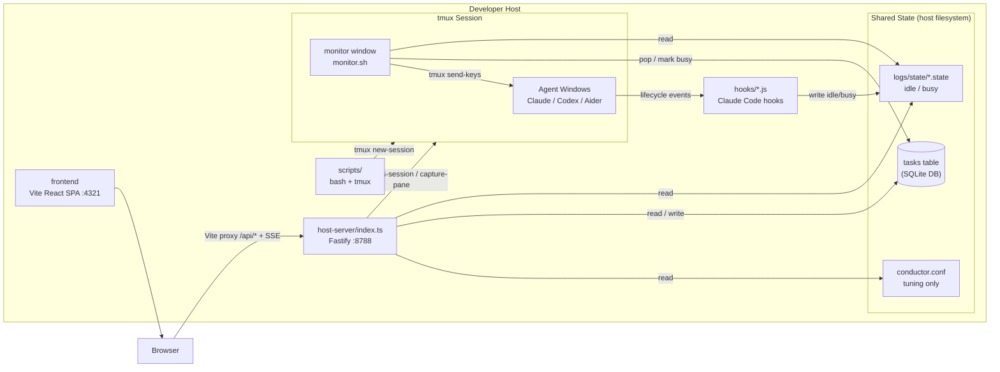
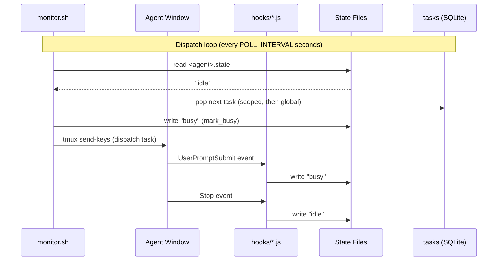

# tmux-conductor

A vendor-agnostic orchestration layer for running multiple AI coding agents (Claude Code, OpenAI Codex, Aider, etc.) in parallel from a single tmux session, with a real-time local web dashboard.

**Repository:** https://github.com/codewizard-dt/tmux-conductor

## Quick Start

Install on the machine that will run your agents:

```bash
curl -fsSL https://raw.githubusercontent.com/codewizard-dt/tmux-conductor/main/install.sh | bash
```

The installer clones the repo, installs npm workspace dependencies, migrates the SQLite database, and registers the Claude Code hooks. Then:

```bash
cd ~/.tmux-conductor      # or wherever you installed it
./scripts/conductor.sh    # create the tmux session and spawn agents
make dev                  # run the host-server (:8788) + dashboard (:4321)
```

Open the dashboard at `http://localhost:4321`.

## Description

tmux-conductor solves the coordination problem that emerges when you want to run many AI coding agents simultaneously: how do you keep them all busy, avoid double-dispatching work, detect when one finishes, and shut everything down cleanly? The system uses tmux as its execution surface — each agent runs in its own window — and a polling monitor loop to detect idle state via per-agent state files (written by Claude Code lifecycle hooks) with a regex fallback for non-Claude CLIs.

Everything runs locally and single-user — no daemon, no Docker, no deployment, no auth. There are two runnable pieces:

- **The native conductor (`host-server/` + `scripts/`)** runs directly on the host. The shell layer (bash + tmux) handles agent lifecycle and task dispatch; the Fastify host-server exposes a real-time HTTP API and SSE stream for the dashboard.
- **The dashboard (`frontend/`)** is a Vite/React SPA that talks directly to the host-server through the Vite dev proxy (`/api/*` → `:8788`).

Tasks are stored in SQLite (at `DB_PATH`, default `data/conductor.db`), optionally scoped to a specific agent. The monitor pops tasks from the DB, pre-writes `busy` to the agent's state file to close the dispatch race window, sends the command via `tmux send-keys`, and then waits for the hook-written `idle` signal before dispatching the next task.

See [`CLAUDE.md`](CLAUDE.md) for the authoritative architecture reference and [`scripts/README.md`](scripts/README.md) for per-script usage and a flowchart.

## Architecture

### Overview

tmux-conductor is a layered orchestration system built on tmux as the process substrate. The architecture is deliberately file-centric on the host — per-agent state files on disk are the canonical idle/busy signal, so the monitor loop and the host-server coordinate without a message broker.

### Components

#### Orchestration Scripts (`scripts/`)

- **Responsibility:** Create and tear down the tmux session, spawn agent windows, and run the monitor dispatch loop.
- **Tech:** bash 4+, tmux 3+
- **Inputs:** `conductor.conf` (POLL_INTERVAL, detection patterns, usage checks, `DB_PATH` — tuning settings only), SQLite DB (agents, bg processes, task queue), per-agent state files
- **Outputs:** tmux windows, dispatched `send-keys` commands, JSONL dispatch log at `$LOG_DIR/dispatch.jsonl`
- **Depends on:** tmux, Claude Code hooks (for state files), bash 4+

#### Claude Code Hooks (`hooks/`)

- **Responsibility:** Write `idle`/`busy` to per-agent state files in response to Claude Code lifecycle events, providing the primary idle-detection signal.
- **Tech:** Node.js 22, stdlib only (no npm deps)
- **Inputs:** Claude Code lifecycle events (`SessionStart`, `UserPromptSubmit`, `Stop`, `StopFailure`) delivered via stdin as JSON
- **Outputs:** `$STATE_DIR/<agent>.state` (values: `idle`, `busy`), `$CONDUCTOR_LOG_DIR/hooks.jsonl`
- **Depends on:** Claude Code CLI (hook registration via `install-hooks.sh`)

#### Host-Server (`host-server/`)

- **Responsibility:** Serve the conductor HTTP API for agent status, task-queue CRUD, pane interaction, and live state updates via Server-Sent Events.
- **Tech:** Node.js 22, TypeScript, Fastify 5, `better-sqlite3`, tsx
- **Inputs:** HTTP requests on port 8788 (env `BACKEND_PORT`); `conductor.conf` (tuning only); SQLite DB; state files
- **Outputs:** JSON responses, SSE stream (`/events`) diff-broadcasting agent and session state every 2 seconds
- **Depends on:** tmux (for `has-session`, `capture-pane`, and pane-liveness checks), `conductor.conf`, state files, SQLite DB

#### Dashboard Frontend (`frontend/`)

- **Responsibility:** Real-time browser UI for monitoring agent state and editing the task queue.
- **Tech:** Vite, React 19, TypeScript, dnd-kit (drag-and-drop), SSE client
- **Inputs:** SSE stream + REST. Talks to the host-server through the Vite proxy (`/api/*` → `:8788`, override with `VITE_API_URL`).
- **Outputs:** Rendered accordion agent list with per-agent state badges, drag-reorderable task lists, add-agent and add-task forms
- **Depends on:** host-server

### Component Interaction



### Data Flow



### Design Decisions

- **State via files, not IPC** — `<agent>.state` files are the canonical idle/busy signal; any process can read them without network or RPC, and they survive monitor restarts. State files do **not** age-expire; liveness is checked via `tmux display -p '#{pane_current_command}'`.
- **`mark_busy` pre-write** — the monitor writes `busy` immediately before dispatching a task to close the race between `send-keys` and the agent's `UserPromptSubmit` hook, preventing double-dispatch.
- **Regex fallback** — when a state file is missing, a regex match against `capture-pane` output decides idle/busy/awaiting, covering Aider/Codex (no hooks) and Claude-without-hooks.
- **Config vs data split** — `conductor.conf` holds only tuning settings (poll interval, detection patterns, usage checks, `DB_PATH`). All operational data (agents, bg processes, projects, task queue, schedules) lives in SQLite.
- **`send-keys -l` (literal mode)** — preserves special characters in prompts; `Enter` is always a separate call to avoid embedding it in the literal string.

## Technologies

**Runtime & Language**
- Node.js 22 (hooks, host-server)
- TypeScript 5 (host-server, frontend — run via tsx / built by Vite)
- bash 4+ (orchestration scripts)

**Frameworks & Libraries**
- Fastify 5 (host-server)
- Vite + React 19 (dashboard SPA)
- `better-sqlite3` (host-server data layer)
- dnd-kit (`@dnd-kit/core`, `@dnd-kit/sortable`) — drag-and-drop task reordering
- tsx — TypeScript execution without a build step
- dotenv — environment variable loading

**Infrastructure**
- tmux 3+ — agent process substrate and pane management
- SQLite (`data/conductor.db`) — host-server operational data

**Tooling**
- ESLint 9
- TypeScript strict mode
- gitleaks (secret scanning, `.gitleaks.toml`)

## Use Cases

- **Parallelizing AI coding work across multiple agents** — configure several Claude Code or Aider instances, each pointed at a different part of the codebase, and let the monitor keep them all fed from a shared task queue.
- **Automated batch task execution** — enqueue dozens of prompts (tests to write, refactors to apply, docs to generate) via the dashboard or `scripts/add-task.sh`, and let the conductor run them unattended, respecting usage limits and cleaning up when done.
- **Multi-vendor agent orchestration** — mix Claude Code, Codex, and Aider in the same session; hook-based idle detection handles Claude natively and `IDLE_PATTERN` regex handles everything else.

## Skills Demonstrated

- **tmux Scripting and Pane Lifecycle Management** — programmatic session creation, window spawning, `send-keys` dispatch, and `capture-pane` output parsing across multiple concurrent processes.
- **Event-Driven State Machine Design** — per-agent `idle`/`busy`/`awaiting` state transitions driven by Claude Code lifecycle hooks, with explicit race-condition handling (`mark_busy` pre-write) and pane-liveness detection.
- **Real-time API Design (Fastify 5 + SSE)** — diff-based Server-Sent Events stream broadcasting only changed agent state, with connection management and CORS handling for cross-origin SSE clients.
- **TypeScript Full-Stack Development (Strict Mode)** — end-to-end TypeScript across the Fastify host-server and the Vite/React frontend.
- **Drag-and-Drop UI (dnd-kit)** — sortable task queue editor with pointer sensor integration and optimistic state updates via SSE.
- **Claude Code Hook Integration** — authoring and registering `SessionStart`, `UserPromptSubmit`, `Stop`, and `StopFailure` lifecycle hooks in Node.js with dedup-safe `~/.claude/settings.json` merge via `install-hooks.sh`.
- **Shell Script Portability (BSD/GNU)** — `sed -i.bak` compatibility, bash 4+ array handling, and macOS/Linux path differences handled throughout.

## Running Locally

### Prerequisites

- tmux >= 3.0 (`brew install tmux` on macOS)
- bash >= 4.0 (macOS ships 3.2 — `brew install bash`)
- Node.js >= 22
- `jq` (used by `install-hooks.sh`)
- Claude Code CLI (for hook registration)

### Setup

```bash
# 1. Install dependencies
cd host-server && npm install && cd ..
cd frontend && npm install && cd ..

# 2. Copy and configure environment
cp .env.example .env

# 3. Migrate the SQLite database
cd host-server && npm run db:migrate && cd ..

# 4. Install Claude Code hooks (for Claude agents)
./install-hooks.sh

# 5. Start the conductor session (launches agents + bg processes from SQLite)
./scripts/conductor.sh
```

Run the host-server and dashboard in one foreground process with:

```bash
make dev      # host-server :8788 + frontend :4321
make ports    # print the URLs
```

Dashboard available at `http://localhost:4321`; host-server API on `http://localhost:8788`. Stop the dev servers with `Ctrl-C`; tear down the tmux session with `./scripts/teardown.sh`.

### Data & Migrations

State is stored in a mix of SQLite and plain-text files on the host filesystem:
- `data/conductor.db` — SQLite database (via `better-sqlite3`): agents, background processes, projects, task queue, schedules
- `logs/state/<agent>.state` — per-agent idle/busy state
- `logs/dispatch.jsonl` — append-only dispatch audit log
- `logs/hooks.jsonl` — append-only hook transition log

To reset the task queue: clear the `tasks` table in `data/conductor.db`. To reset agent state: delete `logs/state/*.state`.

### Health Checks & Smoke Tests

```bash
# Host-server health check
curl http://localhost:8788/api/healthz

# Per-agent state snapshot
curl http://localhost:8788/api/status
```

### Observability

- **Dispatch log:** `logs/dispatch.jsonl` — one JSONL record per dispatch (`ts`, `agent`, `command`, `state`, `state_age_s`, `detection`, `queue`, `queue_remaining`, `pane_tail`).
- **Hook log:** `logs/hooks.jsonl` — one JSONL record per state transition (`ts`, `agent`, `event`, `prev_state`, `new_state`).

### Troubleshooting

- **Monitor double-dispatches tasks** → state file is missing or stale. Verify `install-hooks.sh` has been run and Claude Code hooks are registered (`~/.claude/settings.json` should contain entries pointing at `~/.claude/hooks/tmux-conductor/`).
- **Agent never goes idle** → `IDLE_PATTERN` regex doesn't match the CLI's prompt. Check the last few lines of the agent pane with `tmux capture-pane -pt conductor:agent-name` and update `IDLE_PATTERN` in `conductor.conf`.
- **Dashboard shows "Conductor host-server not reachable"** → the host-server isn't running on `:8788`. Start it with `make dev` (or `cd host-server && npm run dev`).
- **`conductor.sh` fails with "kill-session: session not found"** → safe to ignore; this is the pre-flight cleanup for an already-absent session. The script continues normally.
