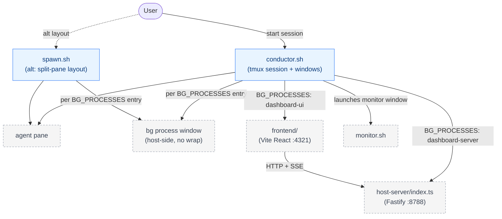
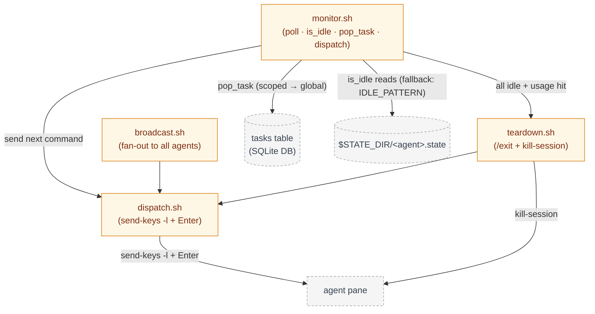
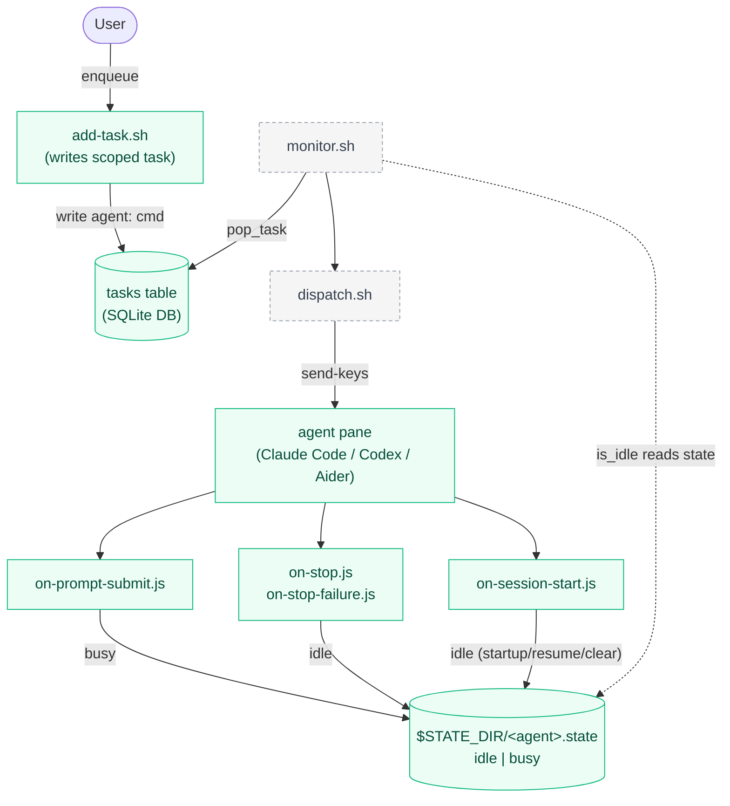

# scripts/

Orchestration scripts for tmux-conductor. This directory contains every shell entry point the user or the monitor invokes at runtime. Configuration lives one level up in `../conductor.conf`; hook scripts (Node.js) live in `../hooks/`.

See also: [`../CLAUDE.md`](../CLAUDE.md) for the full project overview and [`../conductor.conf`](../conductor.conf) for configurable env vars.

## Architecture

Three views of the same system. **Setup / Entry** is how a user launches the tmux session. **Orchestration loop** is the monitor polling agents and dispatching commands. **Task lifecycle** is how a task travels from `add-task.sh` through the queue to an agent pane and back via hooks. Nodes with a dashed outline are owned by another view and shown only as context.

### Setup / Entry



### Orchestration loop



### Task lifecycle



## conductor.sh

Entry point for a conductor session. Creates the tmux session named `$SESSION_NAME`, spawns one window per entry in `AGENTS`, and launches the `monitor` window running `monitor.sh`. Reads `SESSION_NAME`, `BG_PROCESSES`, `STATE_DIR`, and `LOG_DIR` from `../conductor.conf`. Agents are loaded from SQLite via `load_agents()`.

Each entry in `BG_PROCESSES` also gets its own tmux window, created after the agent windows and before the monitor window. Bg processes run on the **host** (no `CONDUCTOR_AGENT_NAME` env prefix) so things like `pnpm dev` execute in the same shell environment as the user's dev workflow.

Usage:
```
scripts/conductor.sh
```

## spawn.sh

Split-pane alternative to `conductor.sh`. Reads the same configuration but lays agents out within a single window using `tmux split-window` + `select-layout tiled` instead of separate windows. Useful when you want all agent panes on one screen at a glance. Also splits one pane per `BG_PROCESSES` entry (host-side) at the end of the agent splits.

Usage:
```
scripts/spawn.sh
```

## monitor.sh

The main polling loop. Every `POLL_INTERVAL` seconds it checks each agent with `is_idle` — primarily by reading `$STATE_DIR/<agent>.state` (written by the Node.js hooks), falling back to the `IDLE_PATTERN` regex against `capture-pane` output when the state file is missing or stale. On idle, it calls `pop_task_sql` against the SQLite DB (scoped tasks first, then global) and hands the command to `dispatch.sh`. When the queue is empty for a given agent, the agent simply stays idle — there is no default-command fallback. Appends a JSONL record per dispatch to `$LOG_DIR/dispatch.jsonl` and inline logs to `$LOG_DIR/monitor-*.log`. When every agent is idle AND `USAGE_CHECK_CMD` fails for every agent, it auto-invokes `teardown.sh`.

Each poll also runs a liveness check over `BG_PROCESSES` window names (slugs, see below): if `tmux has-session -t "$SESSION_NAME:=$bg_name"` fails, monitor logs `WARN: bg '<slug>' — window not found` and writes `dead` to `$STATE_DIR/bg-<slug>.state`. The slug is `<projectName>-<name>` (bare name if the process has no project); bg process names are unique per project, so `scripts/lib/db.sh` `load_bg` emits the slug and `BG_NAMES`/`BG_DIRS`/`BG_CMDS` are keyed by slug. The bg-to-agent link is retired (TASK-0197): `load_agents` no longer joins `bg_processes`, `conductor.sh`/`spawn.sh` no longer inject `CONDUCTOR_BG_NAME`/`LOG`/`STATE` into any agent, and `AGENT_BG_LINKS` is gone from `conductor.conf`; `project_id` is the sole access boundary and the project-scoped `dev-commands` skill is the agent interface. The `bg_processes.linked_agent_id` column was dropped in schema v12 (TASK-0198; a table rebuild that first seeds a still-NULL `project_id` from the linked agent's project). The host-server's `/bg-processes/:slug` routes use the same slug, including `POST /bg-processes/:slug/restart` (atomic stop+start that keeps `pipe-pane` capture attached and appends a `--- restart <ts> ---` marker to `bg-<slug>.log`; see `host-server/bgRestart.ts`). Legacy `bg-<name>.log`/`bg-<name>.state` files from before per-project uniqueness are left in place and ignored; delete stale ones by hand. When the window exists, `bg_pane_exited()` applies the same `#{pane_current_command}` rule as `pane_dead()`: a pane back at a plain shell (and a launch command that is not itself a shell) writes `exited`, otherwise `running` (an empty command fails toward `running`). The host-server reports the same idea as `BgStatus.liveness` (`running`/`exited`/`stopped`, where `stopped` = no window) and additionally applies a `BG_STARTUP_GRACE_MS` (3 s) startup grace, dated from tmux `#{window_activity}`, during which a shell still reads `running`; the monitor has no grace. Liveness is display-only, with no dispatch gating. `scripts/verify-bg-liveness.sh` checks the classification on a private tmux socket. Bg processes are never dispatched to and never affect the `all_idle`/`all_usage_hit` shutdown decision.

Usage:
```
scripts/monitor.sh
```

## dispatch.sh

Sends a single command to a single tmux target pane. Uses `tmux send-keys -l` (literal mode) to preserve special characters in prompts, followed by a separate `Enter` keypress — never embedded in the literal string. Called by `monitor.sh`, `broadcast.sh`, and `teardown.sh`.

Usage:
```
scripts/dispatch.sh <target> <command>
```

## broadcast.sh

Fan-out wrapper. Iterates over `AGENTS` and invokes `dispatch.sh` for each pane that currently exists in the session. Useful for sending `/clear`, `/status`, or any command to every agent at once.

Usage:
```
scripts/broadcast.sh <command>
```

## teardown.sh

Graceful shutdown. Sends `/exit` to each agent via `dispatch.sh`, then sends `C-c` (`tmux send-keys ... C-c`) to every `BG_PROCESSES` window so dev servers / watchers get a chance to clean up, sleeps ~10 seconds to let both agents and bg processes flush, then runs `tmux kill-session` on `$SESSION_NAME`. Takes no arguments.

Usage:
```
scripts/teardown.sh
```

## add-task.sh

Convenience enqueuer for the task queue. Uses `basename "$PWD"` as the agent-scope prefix and writes a scoped task `<agent>: <command>` to the SQLite DB. Intended to be run (or aliased) from within the target project directory so scoped tasks land on the right agent without manual prefixing.

Usage:
```
scripts/add-task.sh <command words...>
```

## verify-dev-commands.sh

Regression suite for `skills/dev-commands/scripts/dev-commands.sh`'s four subcommands (`list`/`status`/`tail`/`restart`), with two modes:

- **Default — hermetic (no network, no tmux).** Runs the deterministic offline checks directly against `dev-commands.sh`: the `CONDUCTOR_STATE_DIR`/`CONDUCTOR_LOG_DIR` FATAL guards, the offline `list`/`status`/`tail` fallback paths (`BACKEND_PORT` points at an unused port so every `curl` call fails deterministically), `tail -n`'s argument-order flexibility and escape stripping, slug resolution (TASK-0196), `list [--all]` project scoping (offline only, TASK-0202), and static text assertions on `dev-commands.sh`/`SKILL.md` (the `restart` dispatch, the four-subcommand usage line, the retired `idle/busy/running` vocabulary, and the `--all`/restart-exit-codes documentation). This mode also runs two sibling verifiers as sub-steps and folds their pass/fail into its own summary — `verify-dev-commands-restart.sh` (see above) and `verify-dev-commands-skill-frontmatter.sh` (SKILL.md's disable-model-invocation frontmatter). `verify-dev-commands-install.sh` and `verify-bg-liveness.sh` are standalone siblings and are deliberately **not** folded in (the latter touches a real, if private, tmux socket) — run them separately.
- **`--live` — opt-in, isolated.** Stands up a throwaway host-server + private tmux world under `./tmp/verify-dev-commands/live/` (`scripts/lib/verify-dev-commands-live.sh`'s `run_live_scenario`, sourced only when `--live` is passed) and runs the agent-driven bg-process-restart scenario end to end through the real API, real tmux and the real `dev-commands.sh` client — never the operator's real `conductor.conf`, DB, tmux server/session, or port 8788/4321.
  - *Isolation:* a private `conductor.conf` (own `DB_PATH`, `STATE_DIR`, `LOG_DIR`, `SESSION_NAME`) selected via `CONDUCTOR_CONF`; a private tmux server addressed only through its own socket dir (`TMUX_TMPDIR`); `BACKEND_PORT` an unused high port (default `18789`, override with `VERIFY_LIVE_PORT`); the host-server started in the background with the repo's `tsx` and torn down (plus `tmux kill-server` against the private socket only) by a `trap` on `EXIT`/`INT`/`TERM`.
  - *Safety refusals (exit 3):* belt-and-suspenders checks that the live port is never `8788`, the session name is never `conductor`, and the scratch `CONDUCTOR_CONF` path — whether computed or inherited from the environment — never resolves to the repo's real `conductor.conf`.
  - *SKIPPED (exit 0, not a failure):* `tmux`/`node`/`jq` missing, `host-server/node_modules` not installed, the repo path containing whitespace, or the chosen port already busy.
  - *Scenario:* seeds two projects (`alpha`/`beta`), one agent and one `dev` bg process in each, through the real API, then asserts (25 PASS lines, each a named check): project-scoped `list`/`list --all`; a `launchCmd` with a double quote, `$HOME` and a backtick running literally (TASK-0190's quoting fix); killing a process → `liveness: exited`; escape-free `tail`; an agent-driven restart (exit 0, exactly one log marker, new output after it, `liveness: running`, one `outcome:restarted` audit line naming the caller, `GET /api/status`'s `lastRestart.caller`); an immediate second restart (exit 5, cooldown, no second marker, one `outcome:cooldown` audit line); a cross-project restart by slug (exit 3, `outcome:denied`/`project-mismatch`, target process untouched); an unknown `X-Conductor-Agent` header (403, no marker added); a header-less dashboard restart inside the agent's cooldown (succeeds, audited `callerKind:dashboard`); and a final check that no fixture window leaked onto the operator's real tmux server.

Usage:
```
bash scripts/verify-dev-commands.sh
bash scripts/verify-dev-commands.sh --live
```

An unknown flag prints usage and exits 2. Artifacts land in `./tmp/verify-dev-commands/` (gitignored), never `/tmp`.

## Archived Scripts

The following scripts are preserved in `scripts/.archive/` for reference but are no longer part of the active system:

- `scaffold.sh` — generated `devcontainer-compose.yml` and `.devcontainer/devcontainer.json`; superseded by local-agent model (ROADMAP-001)
- `agent_exec.sh` — host-side container exec wrapper; superseded by local-agent model (ROADMAP-001)

## host-server/ (repo root, was `backend/`)

The native Fastify HTTP server backing the Vite React dashboard. Runs on `127.0.0.1:8788` (env `BACKEND_PORT`). Runs **directly on the host/VPS, never Dockerized** — in dev via a dedicated tmux window (`BG_PROCESSES`) or `make dev`, in production under systemd. All operational data (agents, queue, bg processes, projects, schedules) lives in SQLite and is accessed through `host-server/db.ts`.

| File | Purpose |
|------|---------|
| `host-server/index.ts` | Fastify app: `GET /status`, `GET /agents`, `GET\|POST /queue/:agent`, `PUT /queue/:agent/reorder`, `DELETE /queue/:agent/:index`, `GET /agents/:agent/tail`, `POST /agents/:agent/keys`, `POST /agents/:agent/upload`, `GET /skills`, `GET /agents/:agent/skills`, `GET /events` (SSE), `GET /healthz` |
| `host-server/config.ts` | Reads and parses `conductor.conf` (tuning settings only) and resolves `DB_PATH` / state dir relative to the conf file |
| `host-server/db.ts` | better-sqlite3 data layer — agents, queue, bg processes, projects, schedules |
| `host-server/state.ts` | Pane-liveness and agent-state helpers used by status detection |

Usage:
```
cd host-server && npm start
```

Host-server tuning keys in `../conductor.conf` (beyond the polling/pattern settings):

| Key | Default | Purpose |
|-----|---------|---------|
| `BG_RESTART_COOLDOWN_S` | `30` | TASK-0193: positive integer seconds an identified agent caller (one sending the `X-Conductor-Agent` header) must wait after ANY successful restart of the same bg process before it may restart it again (HTTP 429 with `Retry-After`). Header-less dashboard callers are exempt. A runaway-loop guardrail, not authentication. Every restart attempt is audited to `$LOG_DIR/bg-restarts.jsonl` |

**Bg restart audit log and caller header (TASK-0193).** `POST /bg-processes/:slug/restart` appends one JSONL line per attempt to `$LOG_DIR/bg-restarts.jsonl`:

| Field | Meaning |
|-------|---------|
| `ts` | ISO timestamp |
| `bg` | bg process slug (`<project>-<name>`) |
| `callerKind` | `agent` (request carried `X-Conductor-Agent`) or `dashboard` (no header) |
| `caller` | raw header value, or `null` |
| `outcome` | `restarted`, `cooldown`, `failed`, or `denied` (`denied` is reserved for the same-project guard, TASK-0194) |
| `cooldownRemainingS` | on `cooldown` |
| `mechanism` | `respawn-window` or `new-window`, on success |
| `step`, `status` | on `failed` (a session-not-running 409 is logged as `failed` / `session-check`; an unknown-slug 404 is not logged) |

- **Header convention:** `X-Conductor-Agent` is the raw tmux window/agent name (`<project>-<name>` for project agents; `dev-commands` sends its `CONDUCTOR_AGENT_NAME`), trimmed, control characters stripped, capped at 128 chars, recorded verbatim. Absent or empty means a human/dashboard caller.
- **Cooldown:** an identified agent caller gets 429 `{ error: 'restart cooldown', retryAfterS, lastRestartAt, lastRestartBy }` plus a `Retry-After` header when anyone last restarted the process successfully less than `BG_RESTART_COOLDOWN_S` ago. Dashboard callers are exempt but still logged; a failed restart does not arm the cooldown. Last-success state is seeded lazily from the tail of the log, so a host-server restart does not reset it. `BgStatus.lastRestart` (`{ at, caller } | null`) exposes the last success.
- **Caveat:** this is a guardrail against runaway restart loops, not authentication. The host-server is single-user localhost with no auth, so an agent that omits the header bypasses the agent cooldown (and is logged as `dashboard`).
- **Known limit:** the log is not rotated (one line per attempt, like the other JSONL logs).

**Agent-facing restart client: `skills/dev-commands/scripts/dev-commands.sh restart <name>` (TASK-0203).** A thin client over the restart route above; the server owns the same-project guard (403), the cooldown (429) and the audit, and the script sends `X-Conductor-Agent: $CONDUCTOR_AGENT_NAME` (omitted when unset, which the server treats as the dashboard). `<name>` is a slug or a bare name: exact slug, else a bare name within the caller's project (via `/api/agents/whoami`), else a bare name matching exactly one process machine-wide; an ambiguous name exits 1. It needs the host-server (no offline fallback), never retries, and has no confirmation prompt. Exit codes: `0` restarted, `1` usage / unknown / ambiguous, `2` host-server unreachable, `3` refused (403), `4` tmux session not running (409), `5` cooldown (429), `6` server failure or unexpected response. Agent guidance is in `skills/dev-commands/SKILL.md`.

**Agent-facing `status` / `tail` / `list` (TASK-0204).** `status <slug>` is online-first: it prints `BgStatus.liveness` (`running` | `exited` | `stopped`, the authoritative signal), the window, `lastRestart` (`<ts> by <caller>`, `never`, or omitted by an older server) and the poll-lagged state file, then one sentence interpreting the liveness. It exits 0 whenever the process is found (even when `exited`) and 1 for an unknown name; against a server without `liveness` it prints `liveness: unknown (host-server predates liveness reporting)` and falls back to the window. Offline (server unreachable or `jq` missing) it prints the state file with its meaning in the `running` / `exited` / `dead` vocabulary (older `alive`/`idle`/`busy` values are flagged `(legacy value)`) and `Live cross-check unavailable (...)`. `tail <slug> [-n N]` reads `GET /api/bg-processes/<slug>/tail?lines=N&format=text` (ANSI stripped, `\r` redraws collapsed, `--- restart <ts> ---` markers) and prints it as-is; `N` must be a positive integer and is clamped to the server cap of 1000; an empty body prints `(no output yet for <slug>)`; 404 exits 1 with candidates. Offline `tail` reads `bg-<slug>.log` through a best-effort `sed` escape strip and says so on stderr. `list` lines now read `<slug> — liveness: <running|exited|stopped|unknown>, state: <s>, window: <bool>[, project: <p>]`. `status`/`tail`/`restart` share one project-aware name resolver (ambiguity exits 2 for `status`/`tail`, 1 for `restart`); offline, bare names resolve against the state-file names only.

Test: `bash scripts/verify-dev-commands-restart.sh` (Node stub HTTP server on an ephemeral port under `./tmp/verify-dev-commands-restart/`; despite its name it also covers the online `status`/`tail`/`list` output, 149 checks; `TASK-0208` adds it to the aggregate verify run). The offline paths (state-file `status`, escape-stripping `tail`) are covered by `bash scripts/verify-dev-commands.sh`.

## frontend/

The Vite React single-page app that consumes the host-server. Runs on `localhost:4321` (env `FRONTEND_PORT`). Displays a real-time accordion list of agents with state indicators and an inline queue editor; subscribes to the `GET /events` SSE stream for live updates. The Vite dev proxy forwards all `/api/*` requests to the host-server on :8788 (env `PROXY_TARGET`).

Usage:
```
cd frontend && npm run dev
```

Open `http://localhost:4321` in your browser.

---

## Going-forward summary

| Script | Going forward? |
|--------|---------------|
| `conductor.sh` | **Essential** |
| `spawn.sh` | **Essential** |
| `monitor.sh` | **Essential** |
| `dispatch.sh` | **Essential** |
| `broadcast.sh` | **Useful** |
| `teardown.sh` | **Essential** |
| `add-task.sh` | **Useful** |
| `verify-awaiting-detection.sh` | **Useful** — TASK-0231 / BUG-0013 repeatable check: extracts `monitor.sh`'s `is_idle()` (and the `awaiting_window`/`busy_visible` helpers it needs) into a stubbed-tmux harness and checks it classifies every pane in the shared fixture set `host-server/fixtures/awaiting-panes/manifest.json` the same way `host-server/state.ts` does (that side is pinned by `host-server/state.test.ts`). TASK-0235 extends the manifest beyond `awaiting` to `stalled`, `exited` (optional `paneCurrentCommand` field) and `busy-recovered`; `stalled` is host-server-only, so the bash side asserts it classifies as plain busy. Usage: `bash scripts/verify-awaiting-detection.sh` |
| `verify-last-payload.sh` | **Useful** — TASK-0229 hermetic check of the `last_prompt` sidecar behavior (real hook scripts, temp state dir under `./tmp/`, safe to run while agents are live) plus the related host-server/frontend unit suites. Usage: `bash scripts/verify-last-payload.sh [--skip-suites]`; the human live round-trip recipe is in `hooks/README.md` ("Verifying `last_prompt`") |
| `verify-worktree-any-agent.sh` | **Useful** — UAT-0218 opt-in live harness for the "Create worktree" and "Clone into new worktree" flows. Brings up a private host-server (own conf/DB/state/tmux socket/session, port `UAT_PORT`, default 18790) plus fixture repos under `./tmp/uat-0218/`, asserts through the real API, git and tmux, prints `PASS:`/`FAIL: caseN` lines and `ALL PASS` / `FAILED: k case(s)`; `SKIPPED` (exit 0) when a tool is missing or the port is busy. Never touches the real conf, DB, port 8788 or default tmux socket. Usage: `bash scripts/verify-worktree-any-agent.sh [--setup-only \| --cleanup \| --stop-server \| --start-server]` |
| `audit-sample-transitions.mjs` | **Useful, manual** — interactive human-audit sampler: shows sampled `to: awaiting` (filterable) records from `logs/transitions.jsonl`, asks y/n/skip, and reports agreement with the dialog-marker heuristic. Requires a human at the keyboard (not CI-runnable). Strictly read-only against `transitions.jsonl`; writes only to `--out` (default `./tmp/audit-sample-<ts>.jsonl`). Usage: `node scripts/audit-sample-transitions.mjs [--file <path>] [--since <ISO>] [--to <state>] [--n <count>] [--seed <int>] [--out <path>]` |
| `report-false-awaiting.mjs` | **Useful** — measures false-awaiting rates (transitions into `awaiting` with no dialog marker, or with `esc to interrupt` visible) from `logs/transitions.jsonl`. Usage: `node scripts/report-false-awaiting.mjs [--since <ISO>] [--file <path>]` |
| `host-server/` | **Active** |
| `frontend/` | **Active** |
| `.archive/scaffold.sh` | **Archived — Docker era** |
| `.archive/agent_exec.sh` | **Archived — Docker era** |

---

## See also

- [`../CLAUDE.md`](../CLAUDE.md)
- [`../conductor.conf`](../conductor.conf)
- [`../hooks/`](../hooks/)
- [`../hooks/README.md`](../hooks/README.md)
- [`../install-hooks.sh`](../install-hooks.sh)
- [`../SCRIPTS_GLOSSARY.md`](../SCRIPTS_GLOSSARY.md)
- [`../wiki/work/tasks/index.md`](../wiki/work/tasks/index.md)
