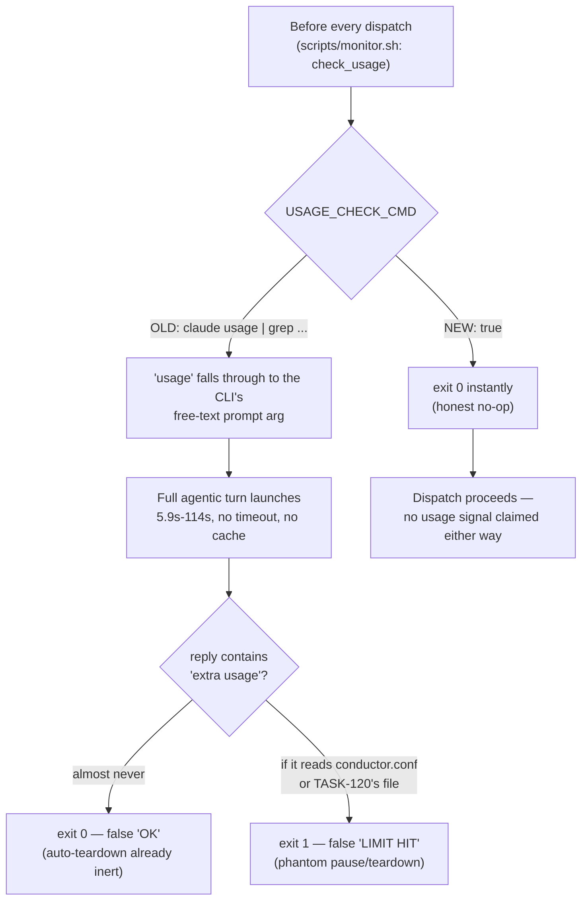

# DEC-0001: Conductor Usage-Check Hardening

> Decision Group covering `conductor.conf`'s `USAGE_CHECK_CMD` — both what it should do (D1) and how a no-op value in it must be written (D2). Both decisions came out of the same investigation, triggered by the same discovery: `monitor.sh` calls `check_usage()` before every dispatch, and its documented example values were wrong in ways that fail silently and severely.

- **File created**: 2026-08-15
- **Last updated**: 2026-08-15
- **Tags (group)**: conductor-conf, usage-monitoring, reliability

## Shared Context

`monitor.sh`'s `check_usage()` (`scripts/monitor.sh:293-311`) runs `conductor.conf`'s `USAGE_CHECK_CMD` before every dispatch and interprets its exit code directly: `0` means usage is OK, non-zero means the limit is hit — which pauses that agent, and (`scripts/monitor.sh:470-475`) triggers a fleet-wide `teardown.sh` if *every* agent is simultaneously idle and usage-limited. This makes `USAGE_CHECK_CMD` a load-bearing safety mechanism: whatever it evaluates to directly controls whether agents get paused or the whole session gets torn down.

Investigation this session found the shipped value, `USAGE_CHECK_CMD='claude usage 2>/dev/null | grep -qi "extra usage" && exit 1 || exit 0'`, was broken in a way that was not merely inert but actively harmful (D1). While deploying the fix, a second, independent landmine was caught in `conductor.conf`'s own documented example for the no-op case (D2). Full research backing D1 is at [[claude-usage-quota-signal|wiki/knowledge/sources/claude-usage-quota-signal.md]] and [[claude-subscription-usage-signal-gap|wiki/knowledge/concepts/claude-subscription-usage-signal-gap.md]].

---

## D1. No automated Claude usage-limit checking — `USAGE_CHECK_CMD='true'`

- **Status**: accepted
- **Date**: 2026-08-15
- **Deciders**: David Taylor (via team-lead)
- **Supersedes**: none
- **Tags**: usage-monitoring, conductor-conf, claude-code

### Context (decision-specific)

`usage` is not a real Claude Code CLI subcommand — `claude --help` (installed v2.1.233) lists no `usage` command among `agents`, `auth`, `auto-mode`, `doctor`, `gateway`, `import`, `install`, `mcp`, `plugin`, `project`, `setup-token`, `ultrareview`, `update`. Per the CLI's own usage line (`claude [options] [command] [prompt]`), the word `usage` fell through to the free-text `[prompt]` argument, so every invocation of the old `USAGE_CHECK_CMD` launched a full interactive/agentic Claude Code turn — not a status check. Direct timing (5 samples): 5.9s, 6.6s, 51.8s, 64.6s, 114.1s (mean ≈48.6s), consistent with variable-duration agentic reasoning rather than a fixed-cost API call. `monitor.sh` calls this once per idle agent per tick, sequentially, with no timeout and no cache.

**Epistemic scope of the "no replacement signal exists" claim.** This rests on: the `claude-api` skill's documentation (scoped to the pay-as-you-go API product, not Claude Code's own subscription-usage surface) not covering it anywhere; direct verification that `claude --help`, `claude auth status`, and `claude doctor` expose no quota data; and one confirming signal from the vendor's own issue tracker, `anthropics/claude-code#33820` ("Expose API rate-limit response headers to hooks and status line scripts"), open at research time, explicitly requesting the capability this decision needed. That is strong evidence of a real, currently-unaddressed gap — it is not an exhaustive audit of Anthropic's entire API/CLI surface, and it does not rule out an undocumented or private mechanism existing somewhere outside the channels checked. The claim is scoped deliberately: whether a locally-running shell script can discover a usage-limit signal through documented, public, non-interactive channels — which is exactly what `USAGE_CHECK_CMD` needs and exactly what was checked.

### Decision Drivers

| # | Driver | Why it matters |
|---|--------|-----------------|
| 1 | Correctness | The check must reflect real usage-limit state, or not claim to check it at all — a check that silently does something else is worse than no check |
| 2 | The check must not consume the resource it claims to measure | The old command burned real Claude usage on every invocation — directly counter to its own purpose |
| 3 | Safety of the pause/auto-teardown mechanism it feeds | False positives pause agents or tear down the whole fleet for a phantom reason; false negatives mean the safety net never fires |
| 4 | Availability of a real, scriptable signal | Any replacement must actually exist as a documented, non-interactive surface — not be invented from an assumption |

### Considered Options

| Option | One-line summary (≤15 words) |
|--------|------------------------------|
| **A. Keep the `claude usage`-based check (status quo)** | Grep a full agentic turn's free-text reply for "extra usage" |
| **B. `USAGE_CHECK_CMD='true'` — no automated checking** | Always report usage OK; matches conductor.conf's own "Always OK" documented example |
| **C. Local heuristic — estimate from transcript parsing** | Extend `host-server/usage.ts` to guess proximity to a user-configured plan tier's rough budget |

### Option Comparison

| Criterion | Option A (status quo) | Option B (no-op, chosen) | Option C (heuristic) |
|-----------|:---:|:---:|:---:|
| Reflects real quota state | ❌ (grep on unrelated text) | ⚠️ (honestly reports "unknown") | ⚠️ (approximate, no published formula) |
| Consumes the resource it measures | ❌ (burns real usage) | ✅ (instant) | ✅ (transcript-only, no API call) |
| False-positive risk (phantom pause/teardown) | ❌ high (literal string "extra usage" sits in `conductor.conf`/`TASK-120` file) | ✅ none (always OK) | ⚠️ real (no published token→quota formula; can be wrong in either direction) |
| False-negative risk (limit hit, not detected) | ⚠️ effectively always (grep almost never matches) | ⚠️ always (by design — never detects) | ⚠️ possible (heuristic drift) |
| Implementation cost | — (already shipped, broken) | Trivial | Non-trivial (new parsing/estimation logic, ongoing maintenance as Anthropic's quota mechanics change) |
| Honesty about capability | ❌ (looks like it checks, doesn't) | ✅ (explicit no-op, documented) | ❌ (looks authoritative, isn't) |

### Trade-off Detail per Option

#### Option A: Keep the `claude usage`-based check
| Aspect | Assessment |
|--------|------------|
| Pros | None found — every property it was meant to provide, it fails to provide |
| Cons | Burns real Claude usage per check; dominates dispatch latency (measured 4×–30×+ `POLL_INTERVAL`'s assumed 15s worst case); false-negative by default (auto-teardown already inert); false-positive landmine (matches its own config text) |
| Risks | A phantom fleet-wide teardown triggered by the agentic reply happening to read/quote `conductor.conf` or `TASK-120`'s file |
| Exit cost | None — already replaced |

#### Option B: `USAGE_CHECK_CMD='true'` (chosen)
| Aspect | Assessment |
|--------|------------|
| Pros | Correct, honest, instant, zero cost, matches the conf's own pre-existing documented "Always OK (no limit checking)" example |
| Cons | No automated protection against genuinely exhausting a Claude subscription's usage — an operator who runs out will discover it via failing/erroring dispatches, not a graceful pre-emptive pause |
| Risks | Reads as an unfinished TODO to a future maintainer, who may "fix" it by reinstating a plausible-looking but broken command (this decision record exists specifically to prevent that) |
| Exit cost | Trivial — one-line config change, reversible instantly if a real signal ever appears |

#### Option C: Local transcript-based heuristic
| Aspect | Assessment |
|--------|------------|
| Pros | Would give *some* signal rather than none, reusing infrastructure (`host-server/usage.ts`) that already parses transcripts for token counts |
| Cons | Anthropic publishes no token-to-quota conversion formula for subscription plans; even Claude Code's own official `/usage` view is self-described as a local-only estimate; a wrong estimate is a cost-control mechanism actively misleading itself |
| Risks | An approximation that looks authoritative invites false confidence — worse than an honest "no check," since it could still pause agents or trigger teardown on bad data, but with the appearance of correctness that makes the failure harder to diagnose |
| Exit cost | High — once shipped, a heuristic becomes load-bearing and hard to walk back without someone noticing it was ever approximate |

### Decision Outcome

**Chosen option**: **Option B — `USAGE_CHECK_CMD='true'`**, because Option A was actively harmful (burned the resource it claimed to measure, false-negative by default, live false-positive landmine) and Option C trades an honest "we cannot check this" for an approximation that can be wrong in ways a cost-control mechanism must not be — an explicit no-op is safer than a plausible-looking guess.

### Decision Flow

### Consequences

| Type | Consequence |
|------|-------------|
| ✅ Positive | Eliminates the false-positive landmine (`conductor.conf`/`TASK-120` both contain the literal string the old grep matched on) |
| ✅ Positive | Dispatch latency is no longer dominated by a check that was 4×–30×+ `POLL_INTERVAL`'s assumed worst case |
| ⚠️ Negative | No automated protection today against genuinely exhausting a Claude subscription — `monitor.sh` will keep dispatching until requests fail for some other reason |
| 🔁 Follow-up | Revisit if `anthropics/claude-code#33820` (or an equivalent official subscription-quota surface) ships — see Validation |

### Validation

| Signal | Threshold | When measured |
|--------|-----------|-----------------|
| A scriptable, non-interactive Claude Max/Pro subscription usage/quota surface becomes available | Any such surface shipping (e.g. `anthropics/claude-code#33820`, or an official API/CLI addition) | Opportunistic — re-check when usage-limit incidents recur, or periodically re-research |

### Links

- Related decisions: [[DEC-0001-usage-check-hardening|DEC-0001#D2: bare `true`, never `/bin/true`]]
- Supersedes: none
- Source: [[claude-usage-quota-signal|wiki/knowledge/sources/claude-usage-quota-signal.md]], [[claude-subscription-usage-signal-gap|wiki/knowledge/concepts/claude-subscription-usage-signal-gap.md]]
- No source task — found and fixed directly in `conductor.conf` during a live investigation session, not via a dedicated `/tackle`.

---

## D2. Use bare `true`, never `/bin/true`, as the `conductor.conf` no-op boolean idiom

- **Status**: accepted
- **Date**: 2026-08-15
- **Deciders**: David Taylor (via team-lead)
- **Supersedes**: none
- **Tags**: conductor-conf, shell-portability, reliability

### Context (decision-specific)

`conductor.conf`'s own comment recommended `"/bin/true"` as the example no-op value for `USAGE_CHECK_CMD` ("Always OK (no limit checking)"). On macOS, `/bin/true` does not exist — the `true` binary lives at `/usr/bin/true`. Attempting to exec a nonexistent path fails with "No such file or directory" and a **non-zero** exit code, which `check_usage()` reads as **LIMIT HIT** — the exact opposite of the intended no-op, and precisely the failure mode D1 exists to prevent (pausing every agent, potentially triggering fleet-wide auto-teardown). This was caught live, while deploying the D1 fix, by directly asserting the exit code and timing rather than trusting the documented incantation: `/bin/true` → exit 1; bare `true` → exit 0 in ~1ms.

### Decision Drivers

| # | Driver | Why it matters |
|---|--------|-----------------|
| 1 | Must produce the intended exit code on macOS | This repo explicitly targets macOS as a first-class platform (`CLAUDE.md`: "macOS default is 3.2 — use `brew install bash`") |
| 2 | The failure mode of getting this wrong is severe and silent | Feeds the same pause/auto-teardown mechanism as D1 — a wrong no-op is not a cosmetic bug |
| 3 | Documented example values in `conductor.conf` are themselves load-bearing | An operator who copies the documented example must get correct behavior, not inherit a landmine |

### Considered Options

| Option | One-line summary (≤15 words) |
|--------|------------------------------|
| **A. `/bin/true`** | The pre-existing documented example; absolute path assuming a Linux-style layout |
| **B. `true`** | Bare shell builtin, no path — portable across bash on macOS and Linux |
| **C. `/usr/bin/true`** | The correct absolute path on macOS specifically |

### Option Comparison

| Criterion | Option A (`/bin/true`) | Option B (`true`, chosen) | Option C (`/usr/bin/true`) |
|-----------|:---:|:---:|:---:|
| Correct exit code on macOS | ❌ (path doesn't exist → exit 1) | ✅ | ✅ |
| Correct exit code on Linux | ✅ | ✅ | ⚠️ (Linux typically has `true` at `/bin/true`, not `/usr/bin/true` — not guaranteed) |
| Portable across both platforms this repo targets | ❌ | ✅ | ❌ (inverse of Option A's problem) |
| Performance | Forks a subprocess | Shell builtin, no fork | Forks a subprocess |

### Trade-off Detail per Option

#### Option A: `/bin/true`
| Aspect | Assessment |
|--------|------------|
| Pros | Works on Linux; was already the documented example |
| Cons | Silently fails on macOS with the worst possible failure mode (exit 1 read as LIMIT HIT) |
| Risks | Exactly the near-miss this decision documents |
| Exit cost | None — already replaced |

#### Option B: `true` (chosen)
| Aspect | Assessment |
|--------|------------|
| Pros | POSIX shell builtin; correct on every platform bash runs on; zero fork overhead; simplest possible correct answer |
| Cons | None identified |
| Risks | None identified — this is the standard, well-understood idiom for "always succeed" in shell scripting |
| Exit cost | Trivial |

#### Option C: `/usr/bin/true`
| Aspect | Assessment |
|--------|------------|
| Pros | Correct on macOS specifically |
| Cons | Reintroduces the same class of path-dependent fragility as Option A, just for the other platform; forks a subprocess for no benefit over the builtin |
| Risks | A future Linux deployment hits the mirror-image of this exact bug |
| Exit cost | Trivial, but pointless — no reason to prefer this over Option B |

### Decision Outcome

**Chosen option**: **Option B — bare `true`**, because it is the only option that is correct on every platform this repo targets, has no fork overhead, and eliminates the entire class of "which OS has the binary at which path" bugs represented by Options A and C — not just for `USAGE_CHECK_CMD`, but as the standing idiom for any future no-op boolean setting in `conductor.conf`.

### Consequences

| Type | Consequence |
|------|-------------|
| ✅ Positive | Eliminates a real, already-hit near-miss caught during the D1 deployment |
| ✅ Positive | Establishes a documented, correct idiom for any future no-op boolean setting in `conductor.conf`, not just this one |
| ⚠️ Negative | None identified — `true` is POSIX-universal |
| 🔁 Follow-up | `conductor.conf`'s own inline comment/example for `USAGE_CHECK_CMD` was corrected in place to show `true`, not `/bin/true` |

### Validation

| Signal | Threshold | When measured |
|--------|-----------|-----------------|
| `USAGE_CHECK_CMD` (or any future `conductor.conf` no-op boolean) exits 0 when set to `true` | Exit code 0, sub-millisecond | Already verified at deploy time (exit 0 in ~1ms); re-verify at every future deploy of a similar no-op setting |

### Links

- Related decisions: [[DEC-0001-usage-check-hardening|DEC-0001#D1: no automated usage-limit checking]]
- Supersedes: none
- No source task — caught and fixed directly in `conductor.conf` while deploying D1's fix.
