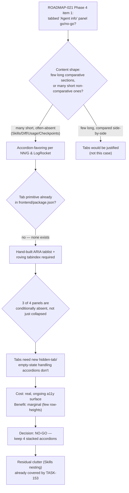

# DEC-0002: AgentDetailModal Agent-Info Panel: Tabs vs. Stacked Accordions

> Single-decision group resolving `ROADMAP-021` Phase 4 item 1: whether `AgentDetailModal`'s Skills/Diff/Usage/Checkpoints panels should consolidate into one tabbed "Agent info" panel instead of remaining four stacked `
` accordions.

- **File created**: 2026-09-13
- **Last updated**: 2026-09-13
- **Tags (group)**: frontend, ux, accessibility

## Shared Context

`AgentDetailModal` (`frontend/src/components/AgentList.tsx:514-926`) renders, below its terminal, up to four independent `
` blocks: Skills, `DiffPanel`, `UsageBreakdown`, `CheckpointList`. Three of the four already opt out of rendering entirely rather than merely collapsing: `DiffPanel` and `UsageBreakdown` return `null` when they have no data, and `CheckpointList` is only mounted at all when the agent has an opted-in git worktree. On the common case (no worktree, no usage history yet), the modal shows one or two of these panels, not four.

This exact idea was already surfaced in same-day prior research on this same modal (`agent-modal-simplification`, 2026-09-13), which scoped it as "Simplification #3" — Medium effort, Medium risk — and explicitly deferred it "pending a product decision." This decision is that product decision, backed by dedicated follow-up research: [[tabbed-agent-info-consolidation|wiki/knowledge/sources/tabbed-agent-info-consolidation.md]] (full primary sources in `raw/research/tabbed-agent-info-consolidation/sources.md`).

---

## D1. Keep Skills/Diff/Usage/Checkpoints as four independent stacked accordions (no-go on tabs)

- **Status**: superseded by [[DEC-0005#D1]] (2026-09-13, same day)
- **Date**: 2026-09-13
- **Deciders**: David Taylor
- **Supersedes**: none
- **Tags**: frontend, ux, accessibility

> **Superseded 2026-09-13**: The product owner gave explicit direction reversing this call — tabs are wanted after all, with a fifth **Terminal** tab (moving the live terminal in from always-visible). See [[DEC-0005#D1]] for the reversal and its added Terminal-tab scope. This block's analysis is preserved unedited below as the historical record of the original (superseded) reasoning.

### Context (decision-specific)

No tab, disclosure-group, or headless-UI dependency exists in `frontend/package.json` (dependencies: React 19, `react-router-dom`, `@dnd-kit/*`, `@xterm/*`; devDependencies: the standard Vite/Tailwind/Vitest/ESLint toolchain). Every existing multi-state UI element in this modal — `ConfirmDialog`, the inline rename input swap, the `
` panels themselves — is hand-built with plain React state and native HTML elements; there is no "reach for a UI kit" convention already in place to lean on for a tabs widget.

### Decision Drivers

| # | Driver | Why it matters |
|---|--------|-----------------|
| 1 | Content shape: many short, non-comparative, frequently-absent sections | Determines which pattern (tabs vs. accordion) is the right fit per established UX guidance, independent of implementation cost |
| 2 | Accessibility implementation cost | Tabs require a hand-built WAI-ARIA `tablist`/`tab`/`tabpanel` composite with roving-tabindex arrow-key handling; native `
`/`
` gets equivalent keyboard/AT support from the browser for free |
| 3 | No existing tab/headless-UI primitive in `frontend/package.json` | Any tabs implementation is new bespoke code with its own correctness surface (a real GitHub issue found during research shows roving-tabindex is an easy, common omission even in shipped tab components) |
| 4 | At-a-glance discoverability of per-panel counts | Accordions show every present panel's summary line (e.g. `Skills (N)`, `Usage (N sessions)`) simultaneously without any click; a tab strip would need this deliberately re-added, not get it by default |
| 5 | Single-user, local-only tool | No broad user base whose aggregate behavior justifies the extra engineering/accessibility surface of a bespoke tabs widget — the cost/benefit bar for "worth building" is higher, not lower, than for a multi-tenant product |

### Considered Options

| Option | One-line summary (≤15 words) |
|--------|------------------------------|
| **A. Tabbed "Agent info" panel** | Wrap all four panels in one hand-built ARIA tablist inside a single `
` |
| **B. Keep 4 stacked accordions (status quo)** | No structural change; each panel remains an independent native `
` |
| **C. Hybrid — flatten low-risk items only, defer tabs** | Ship the already-planned Skills-nesting flatten (`TASK-153`); leave Diff/Usage/Checkpoints as-is |

### Option Comparison

| Criterion | Option A (tabs) | Option B (accordions, chosen) | Option C (hybrid) |
|-----------|:---:|:---:|:---:|
| Matches content shape (short, often-absent, non-comparative) per NN/g & LogRocket | ❌ (tabs suit a few long, comparative sections) | ✅ | ✅ |
| Accessibility implementation cost | ❌ high (hand-built ARIA tablist + roving tabindex) | ✅ none (native browser support) | ✅ none |
| Handles conditionally-absent panels (Diff/Usage/Checkpoints sometimes don't render at all) cleanly | ❌ (needs new hidden-tab or empty-state handling) | ✅ (panel simply doesn't render, as today) | ✅ |
| Preserves at-a-glance per-panel counts | ⚠️ only if deliberately redesigned onto tab labels | ✅ by default | ✅ by default |
| New dependency required | ✅ none, but full bespoke widget | ✅ none | ✅ none |
| Degrades at mobile/narrow widths | ❌ (tab rows are the pattern known to squeeze/truncate/scroll) | ✅ (accordions stack gracefully) | ✅ |
| Implementation cost | Medium (new composite widget + absent-tab handling) | None | Low (isolated Skills-panel change only, already scoped as `TASK-153`) |
| Reversibility | Medium — a shipped tabs widget becomes a UI convention others may copy | Trivial — no change made | Trivial |

### Trade-off Detail per Option

#### Option A: Tabbed "Agent info" panel
| Aspect | Assessment |
|--------|------------|
| Pros | Groups conceptually-related "more about this agent" info under one roof; fewer top-level disclosure widgets on the uncommon case where all four panels happen to be present at once |
| Cons | Must hand-build ARIA `tablist`/`tab`/`tabpanel` + roving-tabindex/arrow-key handling with no existing library; must design a fallback for tabs whose content is sometimes structurally absent (no worktree, no usage, no diff); hides other panels' counts unless deliberately re-surfaced on tab labels; tab rows are a known-weaker pattern at narrow/mobile widths |
| Risks | Shipping a hand-rolled ARIA composite widget with a subtly incomplete keyboard model (missing roving tabindex/arrow keys is a common, easy-to-miss mistake, per a real-world example found during research) |
| Exit cost | Medium — once shipped and adopted as "the" pattern for grouped info, unwinding it back to accordions is a second migration, not a revert |

#### Option B: Keep 4 stacked accordions (chosen)
| Aspect | Assessment |
|--------|------------|
| Pros | Zero new UI code; native keyboard/ARIA support from `
`/`
`; each panel's conditional absence costs nothing (already how `DiffPanel`/`UsageBreakdown`/`CheckpointList` behave today); all present panels' counts stay visible simultaneously; degrades gracefully at mobile widths; matches every existing convention in this exact modal |
| Cons | Up to 4 stacked summary rows when a worktree, usage history, and a diff all happen to coincide for one agent — the uncommon case, not the common one |
| Risks | None material — this is a no-op relative to the current shipped behavior |
| Exit cost | None — no change made; revisiting later (e.g. if panel count grows or panels become genuinely comparative) is a fresh, unconstrained decision |

#### Option C: Hybrid — flatten low-risk items only, defer tabs
| Aspect | Assessment |
|--------|------------|
| Pros | Addresses the one piece of the body that was genuinely disproportionate (Skills' double-nested `
`) without touching Diff/Usage/Checkpoints at all |
| Cons | Functionally indistinguishable from Option B for this decision's specific question (tabs: yes/no) — the Skills flatten is already independently scoped as `TASK-153` and not gated on this decision either way |
| Risks | None beyond `TASK-153`'s own, already-assessed scope |
| Exit cost | None |

### Decision Outcome

**Chosen option**: **Option B — keep the four panels as independent stacked accordions**, because the content — four short, non-comparative, frequently-absent info lookups — is the textbook accordion case rather than the textbook tabs case by the same UX sources that would be cited to justify either choice, and because the concrete, ongoing accessibility-implementation cost of a hand-built ARIA tablist (with no existing primitive to shortcut it) is not offset by a benefit larger than saving a couple of collapsed summary-row heights on the uncommon case where all four panels are present simultaneously. This also matches the framework's cost/risk tie-breaker independently: Option B requires no new dependency and no structural change, so it would win on cost grounds alone even absent the qualitative analysis — the two lines of reasoning agree, making this a confident call rather than a coin flip. Option C's residual value (the Skills-panel flatten) is preserved via the already-existing, independently-scoped `TASK-153` and is not part of this decision's structural question.

### Decision Flow

### Consequences

| Type | Consequence |
|------|-------------|
| ✅ Positive | No new UI code, dependency, or accessibility surface to build or maintain |
| ✅ Positive | Preserves the existing at-a-glance per-panel counts and the graceful mobile-width degradation of accordions |
| ⚠️ Negative | The modal can still show up to 4 stacked collapsed summary rows on the uncommon case where worktree + usage + diff all coincide for one agent |
| 🔁 Follow-up | `ROADMAP-021` Phase 4 item 1's checkbox needs checking off (owner's responsibility, out of scope for this decision record itself); `TASK-153` (Skills-panel flatten) remains the relevant open follow-up for residual body clutter |

### Validation

| Signal | Threshold | When measured |
|--------|-----------|----------------|
| Modal still feels cluttered *after* `ROADMAP-021` Phases 1-3 (badge/header consolidation, Skills flatten) ship | A genuine user complaint about the body panels specifically (not the header) recurs post-Phase-3 | Re-assess opportunistically after Phase 3 closes, not on a fixed schedule |
| Panel count or comparative use grows (e.g., a future "Cost" panel a user wants to flip between with Usage) | Any new panel proposal that is naturally comparative, not just additive | Revisit at the time such a panel is proposed |

### Links

- Related decisions: none (first decision in this area)
- Supersedes: none
- Source: [[tabbed-agent-info-consolidation|wiki/knowledge/sources/tabbed-agent-info-consolidation.md]], [[accessible-tabs-pattern|wiki/knowledge/concepts/accessible-tabs-pattern.md]], [[agent-modal-simplification|wiki/knowledge/sources/agent-modal-simplification.md]]
- Roadmap: `wiki/work/roadmaps/ROADMAP-021-agent-modal-simplification.md` (Phase 4, item 1)
- No source task — this is an explicit go/no-go decision, not an implementation task; `TASK-153` (already filed, independent) covers the one related body-cleanup item this decision leaves untouched.
