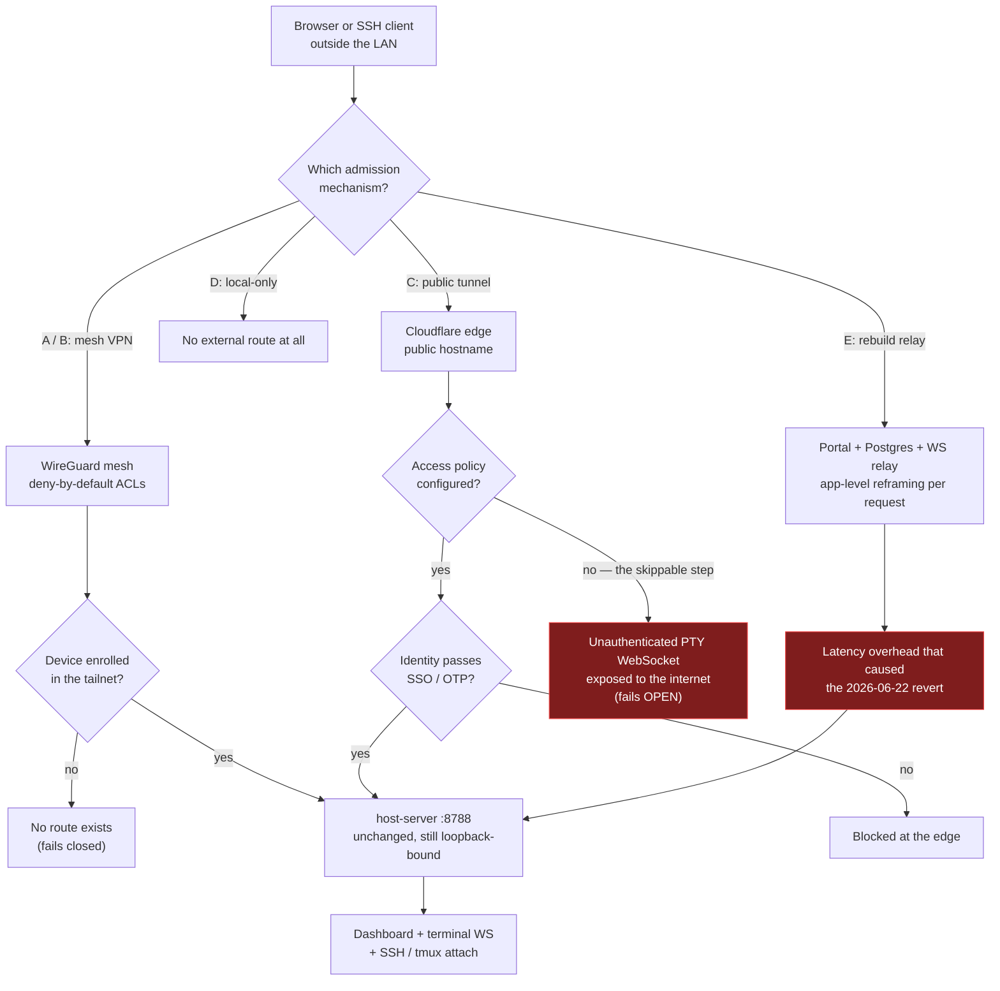
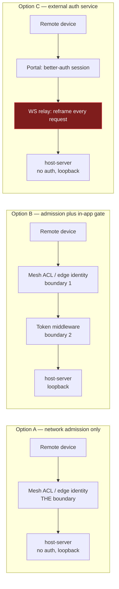

# DEC-0003: Remote Access to the Conductor, and Where Its Trust Boundary Lives

> Decision Group covering external (non-LAN) access to the conductor — **D1**: by what mechanism the dashboard and tmux session become reachable from outside the local network; **D2**: where the trust boundary that protects them lives, i.e. whether `host-server` stays unauthenticated and loopback-bound or grows an authentication layer of its own. The two are tightly coupled — D2 constrains which D1 options are safe — but are independently supersedable: a future multi-user requirement could flip D2 without disturbing D1's transport choice, and vice versa.

- **File created**: 2026-09-13
- **Last updated**: 2026-09-20
- **Tags (group)**: remote-access, security, networking

## Shared Context

`host-server` binds to `127.0.0.1` by default (`host-server/index.ts:2580`, `HOST` env) and **has no authentication anywhere in the codebase** — an exhaustive search for session, token, or API-key checks across `host-server/*.ts` returns nothing. This is deliberate and documented: `CLAUDE.md` describes the system as "fully local and single-user... no daemon, no Docker, no deployment, no auth," and `TASK-058`'s own audit note states it plainly — *"the host-server is loopback no-auth, so the relay + better-auth session are the only trust boundary — every gap there is exploitable."*

The surface that makes this load-bearing rather than academic: `GET /agents/:id/terminal/ws` (`host-server/index.ts:1565`) is a raw WebSocket PTY stream over a live agent pane, and `POST /agents/:agent/keys` sends literal keystrokes into that same pane. Together they are functionally an unauthenticated web shell. **Anyone who can reach port 8788 can read and drive an interactive shell on the host** — so for this application specifically, "reachable from outside" and "remote code execution" are the same sentence unless something sits in front. The `ttyd` advisory (NCC Group, 2017 — unauthenticated RCE through a web terminal's WebSocket callback handler) is the concrete precedent for this failure mode.

**This project has already attempted remote access twice, and reverted both times — which is the main reason this decision exists rather than being re-derived a third time.** [`ROADMAP-005`](../roadmaps/archive/ROADMAP-005-ngrok-tunnel-daemon.md) planned a self-hosted chisel/frp reverse tunnel; it was superseded before any code was written, rejected for exposing a public endpoint with no centralized identity boundary. [`ROADMAP-002`](../roadmaps/archive/ROADMAP-002-hosted-portal-oauth-relay-installer.md) then built the full alternative — a DigitalOcean App Platform portal with better-auth, managed Postgres, device pairing, and an outbound WebSocket relay so the host never needed an inbound port. It reached 25/27 checklist items including a genuine security-hardening pass ([`TASK-058`](../tasks/completed/TASK-058-security-hardening-logs-heartbeat.md): token hashing, rate limiting, 404-not-403 ownership semantics, Origin checks, header safelists, body/in-flight caps) — and was then **fully reverted on 2026-06-22 (commit `ce53273`) because performance overhead was too severe**, not because the security model failed. The code survives only on branch `archive/multi-user-relay`. The project owner subsequently abandoned `ROADMAP-008/009/011/012` outright: *"the multi-user/hosted/cloud direction is no longer on the roadmap — the project is refocusing on localhost-only single-user usage."*

Full research backing both decisions: [[remote-tunnel-access|wiki/knowledge/sources/remote-tunnel-access.md]] and [[remote-access-security-model|wiki/knowledge/concepts/remote-access-security-model.md]], sourced from `raw/research/remote-tunnel-access/`.

---

## D1. Mechanism for reaching the dashboard and tmux session from outside the LAN

- **Status**: accepted
- **Date**: 2026-09-20
- **Deciders**: David Taylor
- **Supersedes**: none
- **Tags**: remote-access, networking, security

### Context (decision-specific)

Two user-facing needs sit behind "access the tmux session remotely," and they have historically been conflated:

| Need | What it actually requires | Code changes needed |
|------|---------------------------|---------------------|
| Terminal-level access (`tmux attach`) | SSH to the host, then `tmux attach -t <session>` | **None** — works today given a network path |
| Dashboard access (the React SPA + `host-server` API) | HTTP/WebSocket reach to ports 4321/8788 | **None** — given a network path and something in front of it |

Neither need is blocked by missing features in this repo. Both are blocked on exactly one thing: **a network path from outside that does not also hand the open internet an unauthenticated shell.** That makes D1 purely an infrastructure choice, not an implementation task — which is why it is recorded as a decision rather than filed as a task.

Layering note: `mosh` (UDP, survives roaming and packet loss, predictive local echo) composes with any option below for terminal use on flaky links — it is a transport-quality improvement on top of the chosen option, not an option itself, since it performs no admission control of its own.

### Decision Drivers

| # | Driver | Why it matters |
|---|--------|----------------|
| 1 | No unauthenticated public reach to port 8788, ever | The exposed surface is an unauthenticated PTY WebSocket plus keystroke injection — public reach is equivalent to host RCE (see Shared Context) |
| 2 | No rebuild of the reverted relay/portal architecture | `ROADMAP-002` built exactly that, correctly, and it was reverted for severe performance overhead; repeating it re-incurs a known, measured failure |
| 3 | Latency budget for the focused terminal stream | The dashboard's primary interaction is a live WebSocket terminal; added per-message hops are directly user-visible, and latency is precisely what killed the prior architecture |
| 4 | Single-user scope | Only the owner's own devices need access — the project's standing direction is local-only, single-user; nothing here requires multi-tenant identity |
| 5 | Operational burden | Any option that adds a service to deploy, monitor, and keep patched competes with a project whose stated shape is "no daemon, no deployment" |
| 6 | Failure mode when misconfigured | Options differ sharply in what happens when a step is forgotten — some fail closed (no access), others fail open (public shell) |

### Considered Options

| Option | One-line summary (≤15 words) |
|--------|------------------------------|
| **A. Managed mesh VPN (Tailscale)** | WireGuard mesh; only enrolled devices can reach the host; backend unchanged |
| **B. Self-hosted mesh VPN (WireGuard / Headscale)** | Same properties as A, but you operate the coordination server yourself |
| **C. Public tunnel + edge identity gate (Cloudflare Tunnel + Access)** | Outbound-only tunnel to a public hostname, with mandatory SSO check in front |
| **D. Stay local-only (status quo)** | Decline external access entirely; LAN and localhost only |
| **E. Rebuild the hosted portal + relay** | Re-land `ROADMAP-002`'s better-auth portal and outbound WebSocket relay |

### Option Comparison

| Criterion | A. Tailscale | B. Self-hosted WG | C. CF Tunnel + Access | D. Local-only | E. Rebuild relay |
|-----------|:---:|:---:|:---:|:---:|:---:|
| Meets driver 1 (no unauth public reach) | ✅ | ✅ | ⚠️ (only if Access configured) | ✅ | ✅ |
| Meets driver 2 (no reverted-architecture rebuild) | ✅ | ✅ | ✅ | ✅ | ❌ |
| Meets driver 3 (terminal latency) | ✅ (WireGuard, one hop) | ✅ | ⚠️ (edge hop, no app-level reframing) | ✅ (n/a) | ❌ (measured cause of revert) |
| Meets driver 5 (no new service to operate) | ✅ | ❌ (you run the control plane) | ⚠️ (managed, but account + DNS + policy) | ✅ | ❌ (portal + Postgres + daemon) |
| Meets driver 6 (fails closed when misconfigured) | ✅ (ACLs deny by default) | ✅ | ❌ (tunnel works *before* Access is added) | ✅ | ✅ |
| Requires `host-server` code change | ❌ none | ❌ none | ❌ none | ❌ none | ✅ substantial |
| Gives a shareable URL without client install | ❌ | ❌ | ✅ | ❌ | ✅ |
| Third party in the trust chain | ✅ Tailscale control plane | ❌ none | ✅ Cloudflare | ❌ none | ✅ DO + Cloudflare-equivalent |
| Solves terminal *and* dashboard with one mechanism | ✅ | ✅ | ⚠️ (dashboard yes; SSH needs separate config) | — | ❌ (dashboard only) |
| Exit cost | Low | Low-Med | Low | None | High |

### Trade-off Detail per Option

#### Option A: Managed mesh VPN (Tailscale)
| Aspect | Assessment |
|--------|------------|
| Pros | Zero code changes; deny-by-default ACLs mean an unconfigured tailnet grants nothing; WireGuard is one hop with kernel-level performance on Linux; covers dashboard **and** SSH/`tmux attach` with one mechanism; Tailscale SSH removes SSH key distribution entirely and logs every session; `tailscale serve` publishes the dashboard tailnet-only without rebinding `host-server` off loopback |
| Cons | Tailscale's control plane joins the trust chain (account compromise ⇒ device enrollment); requires the client installed on every device you connect from — no bare-browser access; a misuse of `tailscale funnel` instead of `serve` would publish the unauthenticated terminal WebSocket to the internet |
| Risks | Identity-provider account takeover is the single point of failure; mitigated by MFA on the backing IdP. Tailscale never sees traffic content (WireGuard is end-to-end between devices), so the exposure is admission, not interception |
| Exit cost | Low — uninstall and the system returns to its current loopback-only state; nothing in the repo depends on it |

#### Option B: Self-hosted mesh VPN (WireGuard / Headscale)
| Aspect | Assessment |
|--------|------------|
| Pros | Identical security properties to A with no third party in the trust chain; Headscale speaks the Tailscale client protocol, so the client-side experience matches A |
| Cons | You now operate the coordination server: key distribution, NAT traversal, uptime, and patching — precisely the operational burden driver 5 exists to avoid, for a single-user system |
| Risks | A self-run control plane that goes unpatched or unavailable is a worse security and reliability position than a managed one; the failure lands on the owner rather than a vendor |
| Exit cost | Low-Medium — teardown is easy, but any invested setup/automation is discarded |

#### Option C: Public tunnel + edge identity gate (Cloudflare Tunnel + Access)
| Aspect | Assessment |
|--------|------------|
| Pros | Outbound-only — no listening port on the host, same as A/B; gives a real public HTTPS URL reachable from any browser with no client install; Access supplies per-identity policy (SSO/email OTP), which is the only option here that scales to other people without re-architecting |
| Cons | **Access is a separate, skippable step** — the tunnel is fully functional, and fully public, before any identity gate exists. For this application that intermediate state is an open shell on the internet. Adds a Cloudflare account, DNS, and policy config to maintain |
| Risks | The dominant risk is procedural, not technical: forgetting or misconfiguring Access (the most commonly skipped step, per Cloudflare-focused write-ups) fails **open**, unlike every other option here, which fails closed |
| Exit cost | Low — delete the tunnel and the DNS record |

#### Option D: Stay local-only (status quo)
| Aspect | Assessment |
|--------|------------|
| Pros | Zero attack surface added, zero cost, zero maintenance; exactly matches the project's standing local-only, single-user direction and requires no action at all |
| Cons | Does not deliver the capability actually asked for — the conductor remains unreachable when away from the machine, which is the entire motivation for this decision |
| Risks | None technically. The practical risk is that the unmet need resurfaces later and gets solved ad-hoc under time pressure (e.g. a quick `ngrok` with no auth), which is a materially worse outcome than any option above |
| Exit cost | None — this is the current state; any option above can be adopted later without unwinding anything |

#### Option E: Rebuild the hosted portal + relay
| Aspect | Assessment |
|--------|------------|
| Pros | Already designed, already security-audited (`TASK-058`), and recoverable from branch `archive/multi-user-relay`; the only option that natively supports multiple distinct users |
| Cons | Was reverted for **severe performance issues** after reaching 25/27 items — the app-level request/response reframing over WebSocket sits directly in the path of the latency-sensitive terminal stream (driver 3); reintroduces a second service plus managed Postgres, against drivers 2 and 5; conflicts with the owner's explicit local-only refocus |
| Risks | Re-incurring a known, measured failure; the performance root cause was never isolated and fixed, only reverted, so a rebuild starts from the same position |
| Exit cost | High — a second deployed service with its own database and auth state is not trivially unwound, as the 2026-06-22 revert demonstrated |

### Decision Outcome

**Chosen option**: **A. Managed mesh VPN (Tailscale)** — confirmed in the decision walkthrough and accepted on 2026-09-20.

Option A is chosen, anchored on driver 1 (no unauthenticated public reach to port 8788), because it is the only option that satisfies drivers 1, 2, 3, 5 and 6 simultaneously: it requires no code change, fails closed by default, adds one WireGuard hop rather than an application-level relay, covers both the dashboard and `tmux attach` with a single mechanism, and does not reopen either previously-abandoned architecture. **Option C** is the correct answer instead if — and only if — a browser-reachable URL for someone without a VPN client turns out to be a genuine requirement, in which case the Access gate must be treated as part of the setup rather than a follow-up. **Option D** remains entirely legitimate if the capability is not worth any added trust chain.

### Decision Flow

### Consequences

| Type | Consequence |
|------|-------------|
| ✅ Positive | Whichever option is adopted, the question stops being re-derived from scratch — the two prior attempts and their distinct failure reasons are now recorded in one place |
| ✅ Positive | For options A/B/C, `host-server` and the frontend are untouched — no implementation task, no code risk, no new dependency in the repo |
| ⚠️ Negative | Options A, B and C each add an external dependency (a control plane, a self-run server, or a CDN account) to a system whose stated value includes having none |
| ⚠️ Negative | Option C's failure mode is inverted relative to every other option — it fails open, so adopting it means accepting a procedural risk that no amount of code review catches |
| 🔁 Follow-up | If A or B is adopted: verify `HOST` stays `127.0.0.1` and that `tailscale serve` (not `funnel`) is used — no repo change, but worth a one-line note in `README`/`CLAUDE.md` so a future maintainer does not "helpfully" rebind to `0.0.0.0` |
| 🔁 Follow-up | If C is adopted: the Access application must be created **before** the DNS route goes live, not after |

### Validation

| Signal | Threshold | When measured |
|--------|-----------|---------------|
| Port 8788 is unreachable from the public internet after setup | External scan from an off-network host returns no response on 8788/4321 | Immediately after adopting any of A/B/C, before first real use |
| Focused-terminal WebSocket latency over the remote path | Within the existing dashboard live-update budget (see [[Dashboard Live-Update Performance Budgets]]); no perceptible regression vs. LAN use | First remote session, then re-check after 30 days of real use |
| `host-server` still binds loopback and carries no auth code | `HOST` unset or `127.0.0.1`; no auth middleware added | Any time D1's mechanism is changed — this is D2's invariant |

### Links

- Related decisions: [[DEC-0003-remote-access-and-trust-boundary|DEC-0003#D2: where the trust boundary lives]]
- Supersedes: none
- Source research: [[remote-tunnel-access|wiki/knowledge/sources/remote-tunnel-access.md]], [[remote-access-security-model|wiki/knowledge/concepts/remote-access-security-model.md]], `raw/research/remote-tunnel-access/`
- Prior art (both abandoned): [`ROADMAP-005`](../roadmaps/archive/ROADMAP-005-ngrok-tunnel-daemon.md), [`ROADMAP-002`](../roadmaps/archive/ROADMAP-002-hosted-portal-oauth-relay-installer.md), [`ROADMAP-009`](../roadmaps/archive/ROADMAP-009-mobile-remote-access.md)
- No source task — this is an infrastructure decision with no repo-side implementation

---

## D2. Where the trust boundary that protects the conductor lives

- **Status**: accepted
- **Date**: 2026-09-20
- **Deciders**: David Taylor
- **Supersedes**: none
- **Tags**: host-server, security, architecture

### Context (decision-specific)

D1 chooses a transport. D2 chooses what is actually doing the *protecting* — and it is the block that determines whether this question stays settled. `ROADMAP-002` was not a failure of security thinking; it was a decision to move the trust boundary **into the application stack** (better-auth sessions, a relay, a Postgres identity store), and the cost of maintaining that boundary in the request path is what made it unshippable. Any future proposal to expose the conductor will implicitly re-open this same choice, so recording it explicitly is what prevents a third rebuild.

The question is narrow and answerable: given a backend with no auth and an unauthenticated PTY WebSocket, does protection come from **who is allowed onto the network** (admission), or from **who is allowed through the application** (authentication)?

### Decision Drivers

| # | Driver | Why it matters |
|---|--------|----------------|
| 1 | The protecting layer must sit *outside* the latency-critical path | The terminal WebSocket is the dominant interaction; `ROADMAP-002` put auth/relay inside that path and the result was reverted |
| 2 | Cost of maintaining the boundary must match a single-user project | A boundary requiring a second service, a database, and session lifecycle management is disproportionate to one user and their own devices |
| 3 | Defence in depth | A single protective layer means one misconfiguration is total compromise — this argues *against* the cheapest option and must be weighed honestly |
| 4 | Reversibility if the requirement changes | Multi-user access is a plausible future need; the chosen boundary should not have to be demolished to get there |
| 5 | Honesty about what the code guarantees | `host-server` must not appear to be authenticated when it is not — a half-measure that looks like auth is worse than a documented absence of it |

### Considered Options

| Option | One-line summary (≤15 words) |
|--------|------------------------------|
| **A. Network admission only** | Boundary is the mesh/edge; `host-server` stays loopback-bound and unauthenticated |
| **B. Minimal in-app gate** | Add a shared-secret or token middleware to `host-server` alongside the network boundary |
| **C. External auth service in front** | Rebuild a portal/relay that terminates identity before reaching `host-server` |

### Option Comparison

| Criterion | A. Network admission | B. Minimal in-app gate | C. External auth service |
|-----------|:---:|:---:|:---:|
| Meets driver 1 (outside latency path) | ✅ | ✅ (single header check) | ❌ (reframing per request) |
| Meets driver 2 (cost proportionate) | ✅ (zero code) | ⚠️ (small, but real, code + secret handling) | ❌ (second service + DB) |
| Meets driver 3 (defence in depth) | ❌ (single layer) | ✅ (two independent layers) | ✅ |
| Meets driver 4 (reversible toward multi-user) | ⚠️ (mesh model is per-device, not per-person) | ⚠️ (shared secret does not identify people) | ✅ (real per-user identity) |
| Meets driver 5 (no false appearance of auth) | ✅ (documented absence) | ⚠️ (a shared secret can read as stronger than it is) | ✅ |
| Code change required in `host-server` | None | Small (middleware + env secret) | Large |
| Known to have failed in this project before | No | No | ✅ yes — reverted 2026-06-22 |

### Trade-off Detail per Option

#### Option A: Network admission only
| Aspect | Assessment |
|--------|------------|
| Pros | Zero code, zero latency cost, zero new failure modes inside the app; preserves `CLAUDE.md`'s stated architecture exactly; the boundary is enforced by audited, purpose-built software (WireGuard/ACLs) rather than hand-rolled middleware |
| Cons | **One layer only.** A compromised enrolled device, a mistaken ACL, or `funnel`-instead-of-`serve` puts an attacker directly on an unauthenticated shell with nothing behind it |
| Risks | The blast radius of any single admission mistake is total. This is the honest cost of the option, and the reason driver 3 is listed rather than quietly dropped |
| Exit cost | None — nothing is built, so nothing must be unbuilt |

#### Option B: Minimal in-app gate
| Aspect | Assessment |
|--------|------------|
| Pros | Restores defence in depth for a fraction of `ROADMAP-002`'s cost — a single header/token check is nowhere near the reverted relay's overhead; means a network-layer mistake is no longer instantly fatal; would also protect against a same-host process or a careless `HOST=0.0.0.0` |
| Cons | Contradicts `CLAUDE.md`'s current "no auth" description, so the docs must change with it; a static shared secret identifies a *credential*, not a person, so it does not advance driver 4; secret handling (storage, rotation, the `.env` rule) becomes a new maintenance surface; the frontend and any script hitting the API must carry it |
| Risks | Scope creep — "just a token" is how the previous auth stack began. Also the risk of false confidence: a shared secret in a local `.env` is meaningfully weaker than session-based auth and should never be described as equivalent |
| Exit cost | Low — one middleware and one env var to remove |

#### Option C: External auth service in front
| Aspect | Assessment |
|--------|------------|
| Pros | Real per-user identity, revocation, and audit; the only option that genuinely satisfies driver 4; already built once and recoverable from `archive/multi-user-relay` |
| Cons | Directly re-incurs the measured performance failure that caused the 2026-06-22 revert; disproportionate to a single user (driver 2); reintroduces a deployment surface the project explicitly removed |
| Risks | The performance root cause was never diagnosed, only reverted — a rebuild therefore carries the same unresolved risk it carried before |
| Exit cost | High — proven by the revert itself |

### Decision Outcome

**Chosen option**: **A. Network admission only** — confirmed in the decision walkthrough and accepted on 2026-09-20.

Option A is chosen, anchored on driver 1 (the protecting layer stays outside the latency-critical path) and driver 2 (cost proportionate to a single-user project), while the system remains single-user, with **Option B** as the deliberate upgrade if the single-layer exposure in driver 3 feels too thin in practice (it is cheap, additive, and does not conflict with A). **Option C** should be adopted only on a genuine multi-user requirement, and then only after the original performance regression is actually diagnosed rather than assumed fixed.

Note that A and B are not mutually exclusive in the way A/C are: B *layers on top of* A rather than replacing it, so choosing A now does not foreclose B later.

### Decision Flow

### Consequences

| Type | Consequence |
|------|-------------|
| ✅ Positive | Makes the implicit explicit: future "let's expose the dashboard" proposals must argue against a recorded decision rather than rediscover the same ground |
| ✅ Positive | Under A or B, `CLAUDE.md`'s "no deployment, no auth" architecture survives intact — the capability is gained without changing what the project *is* |
| ⚠️ Negative | Option A accepts a single protective layer; that is a real, ongoing exposure, not a technicality, and it rests on the owner's network hygiene rather than on anything the code enforces |
| ⚠️ Negative | Under A or B, per-person identity does not exist — access is per-device (A) or per-credential (B), so sharing access with another human is not cleanly expressible |
| 🔁 Follow-up | If B is ever adopted: `CLAUDE.md` and `README` must stop describing the system as unauthenticated, and the new env var goes in `.env.example` only — never in a real `.env` |
| 🔁 Follow-up | If a genuine multi-user need appears, this decision should be superseded by a new one rather than amended — and it should start with `/req-create`, not with restoring `archive/multi-user-relay` |

### Validation

| Signal | Threshold | When measured |
|--------|-----------|---------------|
| No auth middleware has accreted in `host-server` without superseding this decision | Zero auth/session/token checks in `host-server/*.ts` (the search that produced this decision's premise) | Whenever `host-server` routing changes materially, or at any future remote-access review |
| `HOST` remains loopback-bound | `HOST` unset or `127.0.0.1` in all run paths | Same cadence as above |
| Single-layer exposure remains acceptable in practice | No incident, and no unexplained enrolled device or ACL entry, on review | 90 days after D1's mechanism goes live |

### Links

- Related decisions: [[DEC-0003-remote-access-and-trust-boundary|DEC-0003#D1: mechanism for reaching the conductor remotely]]
- Supersedes: none
- Source research: [[remote-access-security-model|wiki/knowledge/concepts/remote-access-security-model.md]], [[remote-tunnel-access|wiki/knowledge/sources/remote-tunnel-access.md]]
- Related component: [[host-server|wiki/knowledge/entities/components/host-server.md]]
- Prior art: [`TASK-058`](../tasks/completed/TASK-058-security-hardening-logs-heartbeat.md) — the security audit performed for the reverted relay architecture
- No source task — this is an architectural constraint, not an implementation
