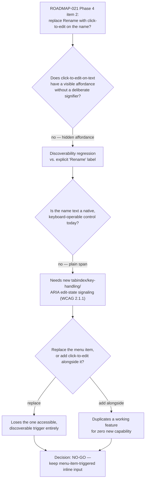

# DEC-0004: AgentDetailModal Rename: Menu Item vs. Click-to-Edit on the Agent Name

> Single-decision group resolving `ROADMAP-021` Phase 4 item 2: whether `AgentDetailModal` should replace its menu-triggered Rename flow (the "Rename" entry in the shipped `AgentActionsMenu`, TASK-148) with click-to-edit directly on the agent-name text.

- **File created**: 2026-09-13
- **Last updated**: 2026-09-13
- **Tags (group)**: frontend, ux, accessibility

## Shared Context

`AgentDetailModal` (`frontend/src/components/AgentList.tsx:530-926`) renders its header as: name/label text (line 752, left side), a run of badges, then — anchored at `ml-auto` on the right — either `AgentActionsMenu` or, when `showRenameInput` is `true`, an inline `<input>` plus Save/Cancel buttons (lines 768-799). Since TASK-148 shipped, `AgentActionsMenu`'s "Rename" item (`agentActionItems[0]`, lines 709-714) is what sets `showRenameInput(true)`, swapping the entire menu component for that input — both still anchored at the same right-hand slot. **The agent-name text itself never moves and is never part of the edit control.**

This item was explicitly deferred pending TASK-148's shipment (`ROADMAP-021` Phase 4 item 2: "evaluate after Phase 2 ships"). It is now unblocked. Backed by dedicated research: [[agent-rename-click-to-edit|wiki/knowledge/sources/agent-rename-click-to-edit.md]] (full primary sources in `raw/research/agent-rename-click-to-edit/sources.md`).

A closely related prior decision in this same modal, [[DEC-0002#D1]] (tabbed "Agent info" panel, accepted no-go), used the same underlying cost structure this decision relies on: no headless-UI/interactive-widget primitive exists anywhere in `frontend/package.json`, so any hand-built custom-widget behavior is new bespoke code with its own accessibility correctness surface, not a free upgrade over the native-element status quo. Tags overlap (`frontend, ux, accessibility`) but the decision areas are distinct — DEC-0002 concerns body-panel structure, this decision concerns the header's rename trigger — so this is filed as a fresh, independent decision rather than a D-block added to DEC-0002; **Supersedes: none**.

---

## D1. Keep Rename as an explicit `AgentActionsMenu` item triggering the existing inline input (no-go on click-to-edit)

- **Status**: accepted
- **Date**: 2026-09-13
- **Deciders**: David Taylor
- **Supersedes**: none
- **Tags**: frontend, ux, accessibility

### Context (decision-specific)

`AgentActionsMenu` (`frontend/src/components/AgentActionsMenu.tsx`) is a single function component rendering native `<button>` menu items — no custom ARIA composite, no external dependency, consistent with every other multi-state control in this modal (`ConfirmDialog`, the rename input itself). Making the agent-name `` itself into a click-to-edit trigger would introduce the first interactive-text element in this codebase, with no existing pattern or library to lean on, and would require relocating the rename `<input>` from its current right-hand action slot to the name's own position — a layout change, not a one-line trigger swap.

### Decision Drivers

| # | Driver | Why it matters |
|---|--------|-----------------|
| 1 | Discoverability of the rename affordance | Click-to-edit-on-plain-text has no visible signifier; an explicit "Rename" label is self-describing by construction |
| 2 | Keyboard/screen-reader accessibility cost | Native `<button>` menu items get WCAG 2.1.1 keyboard operability for free; a clickable text element needs manual `tabindex`/key-handling and a way to signal "this is editable" to assistive tech |
| 3 | No existing interactive-text primitive in `frontend/package.json` | Any click-to-edit implementation is new bespoke code with its own correctness surface, the same constraint `DEC-0002` identified for a hand-built tabs widget in this same modal |
| 4 | Marginal capability gained vs. cost, if added *alongside* the menu item rather than replacing it | The feature is already reachable, accessible, and discoverable; a second trigger duplicates it for zero new capability |
| 5 | Single-user, local-only tool | No broad user base whose aggregate click-savings justify a second, less-accessible entry point to an infrequent action (per `CLAUDE.md`: "fully local and single-user... no auth") |

### Considered Options

| Option | One-line summary (≤15 words) |
|--------|------------------------------|
| **A. Replace the menu item with click-to-edit on the name text** | Remove "Rename" from `AgentActionsMenu`; make the name `` itself the sole edit trigger |
| **B. Keep the menu-item-triggered inline input (status quo)** | No change — `AgentActionsMenu` → "Rename" → existing `showRenameInput` swap |
| **C. Add click-to-edit as an *additional* trigger alongside the menu item** | Keep the menu item; also wire the name text as a second trigger into the same state |

### Option Comparison

| Criterion | Option A (replace) | Option B (status quo, chosen) | Option C (add alongside) |
|-----------|:---:|:---:|:---:|
| Discoverability (visible affordance without a hover/pencil signifier) | ❌ hidden affordance | ✅ explicit, labeled menu item | ⚠️ hidden affordance added on top of an already-discoverable path |
| Keyboard/screen-reader accessibility cost | ❌ new custom-widget surface (manual `tabindex`, key handling, edit-state announcement) | ✅ native button, keyboard-operable for free | ❌ same new surface, purely additive |
| Layout impact | Medium — input must move from the action slot to the name's position | None | Medium — same relocation, or a duplicate input UI |
| New capability delivered | None (same action, different trigger) | — | None — same action reachable a second way |
| Codebase precedent | None — no interactive-text pattern exists anywhere in this codebase | ✅ matches every existing multi-state control (native buttons/inputs) | None |
| Implementation cost | Medium | None | Medium (two triggers to build and keep in sync) |
| Reversibility | Medium — once shipped, becomes the pattern others may copy for other fields | Trivial — no change made | Medium — same exit cost as A, plus removing the redundant second path later |

### Trade-off Detail per Option

#### Option A: Replace the menu item with click-to-edit on the name text
| Aspect | Assessment |
|--------|------------|
| Pros | Removes one menu entry; "feels" more direct for a user who already knows the pattern exists |
| Cons | No visible affordance without a deliberately-added signifier (hover state, pencil icon); requires relocating the existing input from the action slot to the name's position; removes the one universally keyboard-accessible, self-describing trigger the feature has today |
| Risks | Users who don't already know the name is clickable may not find Rename at all — a straight discoverability regression on an action that was, until now, an explicit menu label |
| Exit cost | Medium — once shipped as "the" way to rename, reverting to an explicit control is a second migration |

#### Option B: Keep the menu-item-triggered inline input (chosen)
| Aspect | Assessment |
|--------|------------|
| Pros | Zero new UI code or accessibility surface; native keyboard/ARIA support from `AgentActionsMenu`'s existing `<button>` items; explicit "Rename" label is self-describing with no signifier needed; matches every existing convention in this modal and this codebase |
| Cons | Renaming still takes two interactions (open menu, click Rename) instead of a hypothetical one-click-on-name flow |
| Risks | None material — this is a no-op relative to the current shipped (TASK-148) behavior |
| Exit cost | None — no change made; revisiting later if usage patterns genuinely change is a fresh, unconstrained decision |

#### Option C: Add click-to-edit as an additional trigger alongside the menu item
| Aspect | Assessment |
|--------|------------|
| Pros | Preserves the explicit menu item's discoverability/accessibility while offering a shortcut for users who already know the name is clickable |
| Cons | Duplicates the exact same action through two code paths; still needs a hover/pencil signifier and manual keyboard handling on the name element to be even minimally accessible; delivers no capability the menu item doesn't already provide |
| Risks | A second entry point to the same mutable state (`showRenameInput`) is more surface to keep in sync, for a rarely-used action, in a single-user tool |
| Exit cost | Medium — same exit cost as Option A for the added path, plus the cost of later deciding to remove a now-redundant second trigger |

### Decision Outcome

**Chosen option**: **Option B — keep Rename as the explicit "Rename" entry in `AgentActionsMenu`, triggering the existing inline `showRenameInput`/`handleRename` input**, because click-to-edit-on-text is a textbook hidden affordance with no discoverability parity to an explicit label, and would introduce new keyboard/screen-reader accessibility surface (manual focus/key handling, or an edit-state announcement to assistive tech) that the current native-button trigger gets for free. This is the same cost/benefit shape [[DEC-0002#D1]] already used in this exact modal to reject a hand-built tabs widget: no existing primitive in `frontend/package.json` means any custom interactive control is new bespoke accessibility-correctness surface, and here that cost isn't offset by any new capability at all — the action is already reachable, already keyboard-accessible, and already discoverable. Adding click-to-edit as a *second*, parallel trigger (Option C) fares no better: it carries the same discoverability/a11y liability while duplicating a feature that already works, for a single-user local tool where the click-savings on an infrequent action doesn't clear the bar for new custom-widget surface.

### Decision Flow

### Consequences

| Type | Consequence |
|------|-------------|
| ✅ Positive | No new UI code, custom widget, or accessibility surface to build or maintain |
| ✅ Positive | Rename stays keyboard-accessible and explicitly discoverable via `AgentActionsMenu`, with no signifier design work required |
| ⚠️ Negative | Renaming remains a two-step interaction (open menu → click Rename) rather than a hypothetical single click on the name |
| 🔁 Follow-up | `ROADMAP-021` Phase 4 item 2's checkbox needs checking off (owner's responsibility, out of scope for this decision record itself) |

### Validation

| Signal | Threshold | When measured |
|--------|-----------|----------------|
| A genuine, recurring user complaint that Rename is hard to find inside the menu | Any real friction report, not a hypothetical | Re-assess opportunistically if raised post-acceptance |
| Rename becomes a high-frequency action (e.g. bulk-renaming workflows) | A concrete new workflow that makes two clicks a measured cost | Revisit at the time such a workflow is proposed, favoring a hover-revealed pencil-icon affordance with a real `<input>` swap (per research) over a bare unlabeled clickable span |

### Links

- Related decisions: [[DEC-0002#D1]] — same modal, same cost-structure reasoning (no existing custom-widget primitive), different decision area (body-panel structure vs. header rename trigger)
- Supersedes: none
- Source: [[agent-rename-click-to-edit|wiki/knowledge/sources/agent-rename-click-to-edit.md]], [[accessible-dropdown-menu-pattern|wiki/knowledge/concepts/accessible-dropdown-menu-pattern.md]]
- Roadmap: `wiki/work/roadmaps/ROADMAP-021-agent-modal-simplification.md` (Phase 4, item 2)
- No source task — this is an explicit go/no-go decision, not an implementation task.
