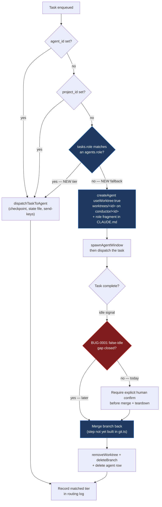

# DEC-0006: How a Queued Task Finds Its Agent — Role Router vs. Ephemeral Worktree Worker

> Single decision (**D1**) covering how a queued task is matched to the agent that executes it: by extending the existing SQL precedence with a capability (role) tier, by provisioning a disposable worktree-backed agent per task, by doing both, or by leaving assignment entirely human-driven as it is today.

- **File created**: 2026-09-18
- **Last updated**: 2026-09-18
- **Tags (group)**: orchestration, task-routing, agents

---

## D1. How a queued task is matched to the agent that executes it

- **Status**: accepted
- **Date**: 2026-09-18
- **Deciders**: David Taylor
- **Supersedes**: none
- **Tags**: orchestration, task-routing, agents

### Context

Today, **no component in this system decides which agent should run a task** — a human or script decides at insert time, and everything downstream is mechanical.

| Stage | Component | Behaviour |
|-------|-----------|-----------|
| Insert | `scripts/add-task.sh`, dashboard `AddTaskForm.tsx` | Human picks the target: agent-scoped, project-scoped, or global |
| Select | `host-server/db.ts::popTask` (+ bash mirror `scripts/lib/db.sh::pop_task_sql`) | Fixed SQL precedence: `agent_id` rows → `project_id` rows → unscoped rows, ordered by `position` |
| Dispatch | `host-server/index.ts::dispatchTaskToAgent` | Pure mechanics: best-effort `stashCheckpoint`, `busy` state-file write, `dispatch.jsonl` record, optional `/clear`, `send-keys` |

A task with no `agent_id` and no `project_id` therefore lands in a global bucket and is picked up by whichever agent next goes idle, regardless of fit.

**The primitives this decision would build on already exist** — verified against the working tree on 2026-09-18, and materially further along than the 2026-09-13 research that prompted this decision recorded:

| Primitive | State | Location |
|-----------|-------|----------|
| Per-agent capability taxonomy | **Exists** — `agents.role`, closed enum `generic\|frontend\|backend\|qa\|devops\|security\|architect` (schema v7) | `host-server/db.ts` |
| Role → behaviour injection | **Exists** — role fragment written into the worktree's `CLAUDE.md` | `host-server/rolePresets.ts::applyRoleFragmentToWorktree` |
| Worktree provisioning | **Exists** — opt-in `useWorktree` creates `<gitRoot>/worktrees/<agentId>` on branch `conductor/<agentId>` | `host-server/git.ts::createWorktree`, `db.ts::createAgent`, `POST /agents`, `POST /agents/:id/worktree` |
| Worktree teardown | **Exists** — `git worktree remove --force` then `git branch -D` on agent delete | `git.ts::removeWorktree`/`deleteBranch`, `DELETE /agents/:id` |
| Pre-dispatch checkpoint / restore | **Exists** | `git.ts::stashCheckpoint` / `applyStash` |
| Per-task capability field | **Missing** | `tasks` has `agent_id`, `project_id`, `position`, `status`, `source`, `schedule_id` — no role/tag column |
| Merge-back / integration | **Missing** | `git.ts` has no merge function; teardown force-deletes the branch |
| Task-completion → teardown trigger | **Missing** | No component observes "this task is done, integrate and tear down" |

Research backing: [[orchestrator-agent-routing|wiki/knowledge/sources/orchestrator-agent-routing.md]], [[multi-agent-orchestration-patterns|wiki/knowledge/concepts/multi-agent-orchestration-patterns.md]], [[ephemeral-worker-per-task-orchestration|wiki/knowledge/concepts/ephemeral-worker-per-task-orchestration.md]], sourced from `raw/research/orchestrator-agent-routing/` (two rounds: `index.md`, `index-2.md`).

### Decision Drivers

| # | Driver | Why it matters |
|---|--------|----------------|
| 1 | A task must be able to reach a suitable agent without a human naming one | This is the actual capability gap; everything else is mechanism |
| 2 | The persistent named-agent identity model must survive | Rename, clone, skills, checkpoints, usage, and the SSE `agent-update` contract are all keyed to a long-lived agent row; the dashboard is built on it |
| 3 | No unmerged work may be silently destroyed | Teardown today is `git worktree remove --force` + `git branch -D` — both discard uncommitted and unmerged work without warning |
| 4 | Routing decisions must be diagnosable after the fact | This project already learned this with status detection (`transitions.jsonl`); a non-deterministic placement with no recorded reason is undebuggable |
| 5 | Reuse existing primitives over building a parallel mechanism | `agents.role`, `git.ts`, and the checkpoint path already exist; a second, competing worktree/capability system would be the `bg_processes` split-brain mistake again |
| 6 | A routing miss must fail open to today's behaviour | Dispatch is the system's critical path; an unmatched task must degrade to the current global-bucket behaviour, never block or error |
| 7 | Routing must only enqueue or spawn, never inject keystrokes beyond the existing dispatch path | `host-server` has no authentication ([[DEC-0003-remote-access-and-trust-boundary\|DEC-0003#D2]]); widening what writes to a live pane widens an unauthenticated surface |

### Considered Options

| Option | One-line summary (≤15 words) |
|--------|------------------------------|
| **A. Role-match router only** | Add a role tier to `popTask`; unmatched tasks stay in the global bucket |
| **B. Ephemeral worktree worker per task** | Every task provisions a fresh worktree-backed agent, runs, merges, tears down |
| **C. Role router with ephemeral fallback** | Role tier first; spawn a disposable worktree agent only when nothing matches |
| **D. Status quo** | Assignment stays entirely human-driven at insert time |

### Option Comparison

| Criterion | A. Role router | B. Ephemeral worker | C. Router + fallback | D. Status quo |
|-----------|:---:|:---:|:---:|:---:|
| Meets driver 1 (task reaches a fit agent unaided) | ⚠️ (only if a matching agent exists) | ✅ | ✅ | ❌ |
| Meets driver 2 (identity model survives) | ✅ | ❌ (agent becomes a unit of work, not an identity) | ✅ | ✅ |
| Meets driver 3 (no silent work loss) | ✅ (nothing torn down) | ⚠️ (requires a merge step that does not exist yet) | ⚠️ (same, but only on the fallback path) | ✅ |
| Meets driver 5 (reuses existing primitives) | ✅ (`agents.role`) | ✅ (`git.ts`, role fragments) | ✅ (both) | ✅ (n/a) |
| Meets driver 6 (fails open to today's behaviour) | ✅ | ❌ (no fallback — spawn is the only path) | ✅ | ✅ |
| Implementation cost | Low | High | Medium | None |
| New machinery required | `tasks` role column + 1 precedence tier (×2 implementations) | merge step, completion trigger, identity rework | A's work + merge step + trigger, on the fallback path only | None |
| Reversibility / exit cost | Low (drop a column and a tier) | High (dashboard and data model changed) | Low-Medium (fallback path is additively removable) | None |

### Trade-off Detail per Option

#### Option A: Role-match router only
| Aspect | Assessment |
|--------|------------|
| Pros | Smallest possible change that closes any part of the gap — `agents.role` already exists, so the work is one nullable `tasks` column plus one `ORDER BY` tier; fully deterministic, so it needs no LLM call, no new failure domain, and no cost gate; matches Azure's guidance to prefer a deterministic dispatcher whenever the right agent is derivable from the task itself |
| Cons | Only helps when a suitable agent already exists and is idle; a task whose role matches nothing still lands in the global bucket and gets run by whatever wakes up first — the original complaint, unaddressed for exactly the cases that motivated it |
| Risks | The role enum is closed and coarse (7 values); tasks that don't map cleanly onto one will accumulate in the unmatched bucket, making the feature look ineffective without revealing why — mitigated only if driver 4's logging lands with it |
| Exit cost | Low — the tier is one clause in two query implementations (TypeScript and bash), and the column is nullable |

#### Option B: Ephemeral worktree worker per task
| Aspect | Assessment |
|--------|------------|
| Pros | The dominant shape in tools purpose-built for coding-agent fleets (dmux, Claude Squad, Vibe Kanban, Conductor, `claude-vibe-squad`); removes the matching problem entirely rather than solving it, since a fit-for-purpose worker is created for each task; git-worktree isolation structurally prevents the parallel-edit conflicts that dominate multi-agent failure taxonomies |
| Cons | Changes what "an agent" means in this codebase — from a durable identity with a name, skills, usage history, checkpoints and a dashboard row, to a disposable unit of work; every surface keyed to persistent agents needs rework, which is disproportionate to the problem being solved |
| Risks | **The teardown trigger depends on idle detection that is known unreliable.** `BUG-0001` (open, P1) documents agents reporting `idle` while background work is still in flight; auto-merging and force-tearing-down a worktree on a false idle destroys in-flight work via `--force`/`-D`. Also, no merge function exists in `git.ts` at all, so conflict handling is entirely unbuilt |
| Exit cost | High — reverting means restoring an identity model the dashboard, SSE contract, and several existing features were rebuilt around |

#### Option C: Role router with ephemeral fallback
| Aspect | Assessment |
|--------|------------|
| Pros | Answers the case A cannot (no matching agent) without paying B's identity-model cost, because the disposable worker is the exception path rather than the rule; both halves reuse primitives that already exist; the fallback is strictly additive — if it is disabled or fails, behaviour degrades to A, and if A misses, behaviour degrades to today's global bucket |
| Cons | Two routing paths to reason about, test, and observe instead of one; the system now has both long-lived and disposable agents in the same `agents` table and the same dashboard, which is a real conceptual cost even though it is not a rewrite |
| Risks | Inherits B's merge and false-idle risks, but confined to the fallback path — which means the fallback must not ship before either `BUG-0001`'s false-idle gap is closed or the merge/teardown step requires explicit human confirmation. A secondary risk is drift: disposable agents accumulating as stale rows and worktrees if teardown silently fails |
| Exit cost | Low-Medium — the fallback path can be removed independently, leaving Option A intact |

#### Option D: Status quo
| Aspect | Assessment |
|--------|------------|
| Pros | Zero code, zero risk, zero new failure modes; the existing three-tier precedence is well understood and has not caused a reported incident; human assignment is a legitimate answer for a single-user tool where the human already knows which agent should do what |
| Cons | Leaves the actual gap open — unscoped tasks are still executed by whichever agent happens to wake first, with no relationship between the task's nature and the agent's role, workdir, or worktree |
| Risks | The need resurfaces ad hoc under time pressure and gets solved inconsistently (e.g. a one-off script that force-assigns tasks), which is worse than either option above |
| Exit cost | None — this is the current state |

### Decision Outcome

**Chosen option**: **Option C — role router with ephemeral worktree fallback**, because it is the only option that satisfies driver 1 for *every* task while preserving the persistent-agent identity model driver 2 protects, and it does so by sequencing primitives that already exist rather than introducing a parallel mechanism.

We will extend `popTask` and `pop_task_sql` with a role-match tier placed after the existing `project_id` tier and before the global tier, matching a new nullable `tasks.role` column against `agents.role`. When no tier matches, we will provision a disposable worktree-backed agent for the task, run it, integrate its work, and tear it down — rather than leaving the task in the global bucket.

Two constraints are part of this decision, not follow-ups to it: the fallback path **must not** perform an automatic merge-and-teardown while `BUG-0001`'s false-idle gap remains open (it must require explicit human confirmation until then), and every routing decision **must** be recorded with the tier that matched, in the manner already established by `transitions.jsonl`.

### Decision Flow

### Consequences

| Type | Consequence |
|------|-------------|
| ✅ Positive | An unscoped task now reaches an agent chosen by its declared role rather than by whichever pane happened to go idle first |
| ✅ Positive | The gap A cannot close (no matching agent exists) is answered by creating one, so no task class is left to the global bucket by design |
| ✅ Positive | Both halves reuse shipped primitives — `agents.role`, `rolePresets.ts`, `git.ts`, the checkpoint path — rather than adding a second capability or isolation system |
| ⚠️ Negative | The `agents` table and dashboard now hold two conceptually different things: durable named agents and disposable task workers |
| ⚠️ Negative | The role enum is closed and coarse (7 values), so task→agent matching is only as expressive as that vocabulary; widening it is a schema change with a CHECK constraint |
| ⚠️ Negative | The routing tier must be implemented twice — `host-server/db.ts::popTask` and `scripts/lib/db.sh::pop_task_sql` — and the two can drift, which is precisely how the `bg_processes` split-brain bug happened |
| 🔁 Follow-up | Add a nullable `tasks.role` column (new schema version) plus the precedence tier in both implementations |
| 🔁 Follow-up | Add a merge function to `git.ts` — none exists today; teardown currently force-deletes the branch |
| 🔁 Follow-up | Add a routing log (tier matched, candidates considered, spawn-vs-dispatch) in the shape of `transitions.jsonl` |
| 🔁 Follow-up | Gate the fallback's merge/teardown behind explicit human confirmation until `BUG-0001` is resolved; revisit when `TASK-133` unblocks |
| 🔁 Follow-up | Decide how disposable workers are presented in the dashboard so they do not read as ordinary agents |

### Validation

| Signal | Threshold | When measured |
|--------|-----------|---------------|
| Unscoped tasks dispatched to a role-matched agent rather than the global bucket | ≥ 80% of tasks carrying a `role` reach an agent of that role | 30 days after the router tier ships |
| Work destroyed by fallback teardown | Zero incidents — every teardown preceded by a successful merge or an explicit human confirmation | Every teardown, from first use |
| Routing decisions are reconstructable from logs | 100% of dispatches carry the matched tier; every spawn records why no tier matched | First week after the routing log ships |
| Precedence logic stays consistent across implementations | `popTask` and `pop_task_sql` produce identical tier ordering under the existing verification scripts | Each change to either implementation |
| Disposable workers do not accumulate | No orphaned `conductor/*` branches or `worktrees/*` directories without a live agent row | Weekly for the first month |

### Links

- Source research: [[orchestrator-agent-routing|wiki/knowledge/sources/orchestrator-agent-routing.md]] · `raw/research/orchestrator-agent-routing/index.md` (round 1), `index-2.md` (round 2)
- Concepts: [[multi-agent-orchestration-patterns|wiki/knowledge/concepts/multi-agent-orchestration-patterns.md]], [[ephemeral-worker-per-task-orchestration|wiki/knowledge/concepts/ephemeral-worker-per-task-orchestration.md]]
- Related component: [[host-server|wiki/knowledge/entities/components/host-server.md]]
- Related decision: [[DEC-0003-remote-access-and-trust-boundary|DEC-0003#D2: where the trust boundary lives]] — constrains driver 7
- Blocking dependency for the fallback path: `BUG-0001` (open, P1) and [`TASK-133`](../tasks/TASK-133-sentinel-gate-background-agent-dispatch.md)
- Supersedes: none
- No source task — implementation tasks are follow-ups to this decision
