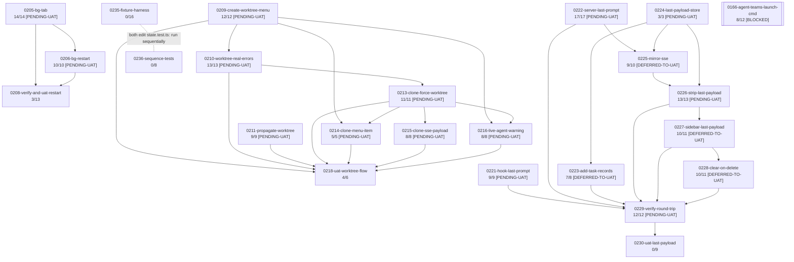

# Task Dependency Graph

> Auto-generated by `/task-assess` on 2026-10-17. Re-run to refresh. Do not edit by hand.

Edges are drawn only between tasks still in the active index; dependencies on archived/done tasks are treated as satisfied. A `pending-uat` prerequisite is treated as sufficient to start a dependent (the repo's working convention; TASK-0208 is already `in-progress` on pending-uat prerequisites). 28 of the 43 active tasks have no active dependency edges and appear only in the waves table.

## Execution Waves (Parallelism)

| Wave | Tasks | Can run in parallel |
|------|-------|---------------------|
| 1 | 001, 011, 012, 128, 130, 133, 140, 151, 162, 0164, 0166 (blocked on human), 0167, 0180, 0185, 0199, 0200, 0205, 0209, 0211, 0221, 0222, 0224, 0231, 0232, 0233 (human gate first), 0234, 0235, 0236 | Yes, no active dependencies. ⚠️ 0235 and 0236 both edit `host-server/state.test.ts`: sequence them. Most of the rest are already fully implemented and only await UAT |
| 2 | 0206 (needs 0205), 0210 (needs 0209), 0223 (needs 0224), 0225 (needs 0222, 0224) | Yes |
| 3 | 0208 (needs 0205, 0206), 0213 (needs 0210), 0226 (needs 0225) | Yes |
| 4 | 0214, 0215, 0216 (need 0213), 0227 (needs 0226) | Yes |
| 5 | 0218 (needs 0209-0216), 0228 (needs 0227) | Yes |
| 6 | 0229 (needs 0221, 0222, 0223, 0226, 0227, 0228) | Single task |
| 7 | 0230 (needs 0229) | Single task |

## Blocking Chains

- ROADMAP-0027 last-payload chain: 0224 → 0225 → 0226 → 0227 → 0228 → 0229 → 0230 (longest, 7 deep)
- ROADMAP-0025 worktree chain: 0209 → 0210 → 0213 → 0214/0215/0216 → 0218
- ROADMAP-0024 background-process chain: 0205 → 0206 → 0208
- Soft (undeclared) constraint: 0235 ↔ 0236 share `host-server/state.test.ts`
