# Task Dependency Graph

> Auto-generated by `/task-audit` on 2026-09-18. Re-run to refresh. Do not edit by hand.

```mermaid
graph TD
  TASK001["TASK-001-skill-detection<br/>20/21"]
  TASK011["TASK-011-immediate-dispatch<br/>7/11"]
  TASK012["TASK-012-sse-tail-stream<br/>21/28"]
  TASK128["TASK-128-monitor-single-instance-lock<br/>6/17"]
  TASK130["TASK-130-dynamic-terminal-pane-sizing<br/>7/11"]
  TASK132["TASK-132-context-window-limit-accuracy<br/>14/14"]
  TASK133["TASK-133-sentinel-gate-background-agent-dispatch<br/>16/20"]
  TASK135["TASK-135-dark-mode-hardcoded-surface-sweep<br/>8/8"]
  TASK140["TASK-140-badge-button-contrast-audit<br/>25/27"]
  TASK146["TASK-146-agent-status-toast-notifications<br/>12/12"]
  TASK151["TASK-151-add-agent-form-modal<br/>4/5"]
  TASK162["TASK-162-details-queued-tasks-into-tabs<br/>9/10"]
  TASK0164["TASK-0164-direct-input-border-no-shift<br/>6/8"]
  TASK0166[["TASK-0166-agent-teams-launch-cmd-preference<br/>9/13 [BLOCKED]"]]
  TASK0167["TASK-0167-agent-role-switcher-modal<br/>16/18"]
  TASK0169["TASK-0169-remove-kanban-columns-agentlist<br/>10/11"]
  TASK0170["TASK-0170-agent-sidebar-project-grouping<br/>10/11"]
  TASK0171["TASK-0171-sidebar-row-status-right-border<br/>4/5"]
  TASK0172["TASK-0172-extract-agent-detail-view<br/>10/10"]
  TASK0173["TASK-0173-sidebar-click-renders-detail-pane<br/>9/10"]
  TASK0174["TASK-0174-preserve-cycling-and-notification-open-in-pane<br/>9/10"]
  TASK0175["TASK-0175-navbar-add-agent-trigger<br/>7/8"]
  TASK0176["TASK-0176-add-bg-process-form-modal-navbar-trigger<br/>9/10"]
  TASK0177["TASK-0177-inactive-agents-into-sidebar-top<br/>10/11"]
  TASK0178["TASK-0178-inactive-agents-open-detail-via-pane<br/>8/9"]

  TASK0169 --> TASK0170
  TASK0169 --> TASK0172
  TASK0170 --> TASK0171
  TASK0170 --> TASK0173
  TASK0170 --> TASK0177
  TASK0172 --> TASK0173
  TASK0173 --> TASK0174
  TASK0173 --> TASK0178
  TASK0175 --> TASK0176
  TASK0177 --> TASK0178

  TASK011 -.-> TASK001
  TASK012 -.-> TASK001
  TASK012 -.-> TASK011
  TASK135 -.-> TASK128
  TASK135 -.-> TASK132
  TASK135 -.-> TASK133
  TASK140 -.-> TASK135
  TASK140 -.-> TASK132
  TASK140 -.-> TASK133
  TASK146 -.-> TASK140
  TASK0169 -.-> TASK0175
  TASK0176 -.-> TASK0169
```

## Execution Waves (Parallelism)

| Wave | Tasks | Can run in parallel |
|------|-------|---------------------|
| 1 | TASK-001, TASK-011, TASK-012, TASK-128, TASK-130, TASK-132, TASK-133, TASK-135, TASK-140, TASK-146, TASK-151, TASK-162, TASK-0164, TASK-0166, TASK-0167, TASK-0169, TASK-0175 | ⚠️ No unresolved `depends_on`, but only a few pairs have *declared* `parallel_safe_with` (TASK-001/011/012; TASK-128/135/132/133/140/146; TASK-0169/0175) — every other pair's safety is undeclared, not proven safe. One explicit non-declared caution found in a task's own Notes: **TASK-135 must not run concurrently with TASK-130** — both edit `AgentList.tsx`/`LogTail.tsx` (noted directly in TASK-135's file, not captured in `parallel_safe_with`). |
| 2 | TASK-0170, TASK-0172, TASK-0176 | Yes — TASK-0170/TASK-0172 both only depend on TASK-0169 and don't share edit scope with each other per their own File-overlap notes being about later tasks; TASK-0176 depends only on TASK-0175. |
| 3 | TASK-0171, TASK-0173, TASK-0177 | ⚠️ TASK-0173 depends on both TASK-0170 and TASK-0172 (Wave 2); TASK-0171 and TASK-0177 both edit `AgentList.tsx` alongside TASK-0173 — their own File-overlap notes say the orchestrator must not run them concurrently with TASK-0172–TASK-0174, despite no hard dependency between TASK-0171/TASK-0177 themselves. |
| 4 | TASK-0174, TASK-0178 | ⚠️ Both edit `AgentList.tsx`/`AgentList.test.tsx`; TASK-0178's own File-overlap note says do not run concurrently with TASK-0174. |

## Blocking Chains

- TASK-0169 → TASK-0170 (sidebar builds on the flat grouped list)
- TASK-0169 → TASK-0172 (extraction needs the column model gone)
- TASK-0170 → TASK-0171 (border needs sidebar rows to exist)
- TASK-0170 → TASK-0173 (detail-pane wiring targets sidebar rows)
- TASK-0170 → TASK-0177 (Inactive section docks at sidebar top)
- TASK-0172 → TASK-0173 (pane render needs `AgentDetailView`)
- TASK-0173 → TASK-0174 (cycling/notification re-verification targets the pane)
- TASK-0173 → TASK-0178 (inactive panel repoints to the pane)
- TASK-0175 → TASK-0176 (both share the NavBar action cluster)
- TASK-0177 → TASK-0178 (repoint needs the panel already in the sidebar)
